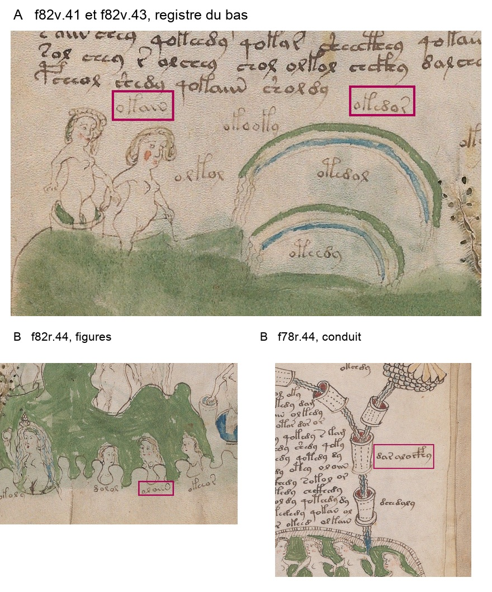

# Le même registre offre un contraste visible entre personnages et arcs

**Le groupe entier `otoly` apparaît à 0 des 2 emplacements de figures et à 0 des 2 emplacements de conduits.** Les deux prédictions strictes ont échoué. La paire la plus informative est sur f82v. Dans un seul registre, deux personnages se trouvent à gauche et deux formes arquées, à double contour, à droite. Les légendes encadrées au-dessus du deuxième personnage et des arcs portent respectivement `okain` et `okedor` dans les deux transcriptions. [Photographie de Yale, f82v](https://collections.library.yale.edu/iiif/2/1006223/full/full/0/default.jpg)

| Paire | Emplacement choisi sur la photographie | Locus | Transcription H | Transcription ZL |
|---|---|---|---|---|
| A | Au-dessus de la tête du deuxième personnage à gauche | f82v.41 | `okain` | `okain` |
| A | Près du sommet du grand arc à double contour | f82v.43 | `okedor` | `okedor` |
| B | Sous le deuxième personnage en partant de la droite, dans la rangée du bas | f82r.44 | `olaiin` | `olaiin` |
| B | À droite du cylindre situé à la jonction de deux branches, au-dessus du bassin | f78r.44 | `daraloikhy` | `dar,alo{ifh}y` |

Sur f82r, trois têtes et leurs inscriptions respectives sont visibles dans le coin inférieur droit de la planche. Le mot encadré est celui du milieu parmi ces trois. Sur f78r, le cylindre encadré par le texte et les deux branches est vertical. Le mot est immédiatement à sa droite. Les éditions divergent sur la segmentation et un signe de cette légende. Ni la segmentation séparée ni la segmentation jointe ne donne la cible. La photographie rapproche les objets et les mots écrits à proximité ; elle ne détermine pas ce que ces mots désignent. [Yale, f82r](https://collections.library.yale.edu/iiif/2/1006222/full/full/0/default.jpg) · [Yale, f78r](https://collections.library.yale.edu/iiif/2/1006214/full/full/0/default.jpg)

## Comment les quatre emplacements ont été choisis

Un lecteur IA a observé six faces disponibles où le catalogue signale des étiquettes de figures ou d’autres motifs. Il a utilisé des cartes enregistrées sur les photographies de Yale, en couvrant les boîtes de mots que le visualiseur permet de repérer. Les numéros de loci tenaient lieu d’étiquettes. Le calage entre les images couleur du visualiseur Voynichese et les JPEG de Yale utilise des correspondances visuelles SIFT et une transformation affine robuste. Sur les trois faces retenues, le 95ᵉ centile de l’écart entre points homologues vaut de 3,87 à 4,52 pixels dans des photographies d’environ 3 700 pixels de haut. Ce chiffre mesure le calage des photographies ; la position et l’étendue de chaque boîte restent éditoriales. Le lecteur a ensuite vérifié visuellement chacune des quatre inscriptions sur l’original. [Cartes utilisées pour choisir](cartes-selection.jpg) · [Coordonnées, origines, dimensions et empreintes](emplacements.json)

| Face examinée | Légendes Ln/Lt dans H | Avec au moins une boîte alignée et couverte |
|---|---:|---:|
| f77r | 10 | 8 |
| f77v | 8 | 3 |
| f78r | 6 | 4 |
| f82r | 13 | 11 |
| f82v | 14 | 10 |
| f83v | 4 | 4 |

Le choix raisonné favorise deux contextes où le contraste se voit sur l’image. Il couvre quatre emplacements parmi 40 repérables sur cet ensemble de six faces. Certaines autres inscriptions de ces faces restaient visibles. Les quatre emplacements choisis étaient masqués. Les deux exemples déjà connus de `otoly`, f75v et f84r, étaient exclus. La prédiction a été consignée, et son empreinte transmise à l’équipe, avant d’afficher les lectures H et ZL des emplacements sélectionnés. Un relevé antérieur de ce manuscrit limite l’indépendance historique de l’épreuve. [Prédictions enregistrées](PREDICTIONS.md) · [Détails des quatre emplacements masqués](lieux-masques.jpg)

Le lien physique au « conduit » est le plus clair pour le cylindre de f78r. L’arc de f82v a une double ligne et s’élève au-dessus d’une zone verte. Sa fonction reste inconnue. L’appariement de f82v contrôle la page et le registre ; l’autre paire est répartie sur deux faces. Le résultat indique que `otoly` échoue comme étiquette systématiquement attendue à ces quatre endroits. Avec seulement deux emplacements par catégorie et aucune occurrence, les données ne mesurent pas une préférence pour une des deux catégories. Les variantes possibles de sens, le statut de nom propre, le mot pour la femme et le mot pour le conduit restent ouverts.

## Reproduction

Dans ce dossier, `python3 verifier.py` lit les loci directement dans les fichiers IVTFF H et ZL du dépôt et imprime les valeurs publiées. L’option `--images /chemin/vers/les/jpg` contrôle les empreintes des originaux Yale f78r.jpg, f82r.jpg et f82v.jpg et régénère les deux planches de détail. Les rectangles des inscriptions sont aux coordonnées natives de la photographie. [Script](verifier.py) · [Lecture brute et empreintes des éditions](resultats.json)
