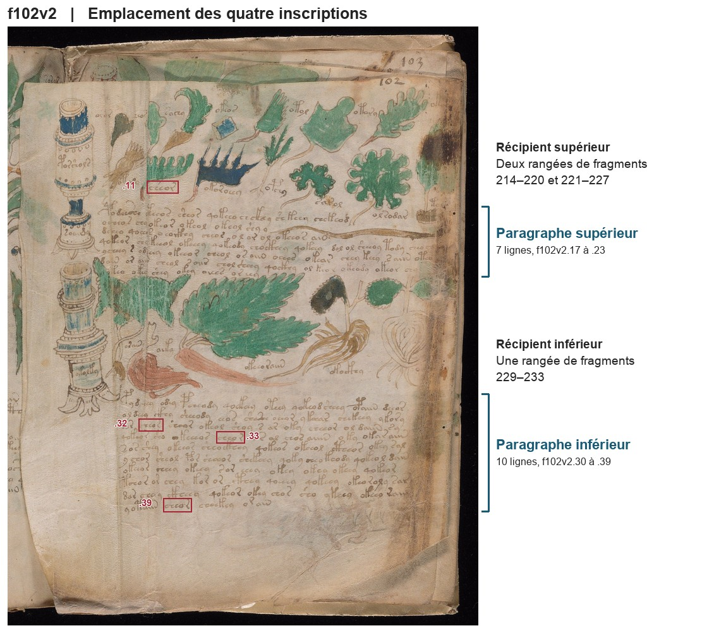

# Le mot écrit sous le fragment végétal 222

**À f102v2, on peut relier le groupe de signes `cheor` à un dessin précis. La page ne dit pas à elle seule si le groupe nomme la plante, un organe ou autre chose.** Le fragment 222 présente une bande verte bordée de lobes en peigne. La légende est juste au-dessous. Le paragraphe qui suit les deux rangées du haut ne reprend jamais le groupe. Ses trois reprises sont aux lignes 3, 4 et 10 du paragraphe inférieur, sous un autre récipient et cinq autres dessins. Les deux transcriptions confirment cette disposition, même quand elles divergent sur les mots voisins. [Page annotée et agrandissements](images/LECTURE.md) · [Notice et fac-similé](https://www.voynich.nu/q19/index.html#f102v2)

## Comment un scribe nomme ce qu’il dessine

Dans le *Gart der Gesundheit* imprimé à Mayence en 1485, on trouve **Aron** sous le dessin et *Die wůrtzel von aaron* dans la notice, « la racine de l’aron ». C’est la construction *X von Y* qui permet d’identifier l’organe et de le distinguer du nom de plante. Sur deux autres notices réservées, une règle fixée à l’avance, « prendre le premier mot assez long répété sur trois lignes », sélectionne une fois *meister* (« maître », introduisant notamment Galien) et une fois le nom de la plante. Dans ce dernier cas, le mot désignant sa racine se répète lui aussi sur trois lignes. Un même dessin offre plusieurs choses dont le texte peut parler. [Photographies, règle et résultats sur les notices réservées](temoin/RAPPORT.md) · [La phrase de l’aron, f. 20v](https://www.digitale-sammlungen.de/view/bsb00032739?page=44)

Le manuscrit rhénan *Von dem Gang des Himels und Sternen*, daté de la seconde moitié du XVe siècle, réunit trois référents sur le même dessin. Une femme ailée tient une plante et des étoiles rouges marquent la constellation. On peut lire le premier mot du paragraphe sur le feuillet, *Virgo*, la Vierge. Cet exemple rend plausible qu’un texte lié à une figure nomme un signe zodiacal. Aucune dépendance entre ces ouvrages et le Voynich n’est établie. [Morgan Library, MS M.384, f. 10r](https://ica.themorgan.org/manuscript/page/6/77318) · [Photographie de l’original](https://ica.themorgan.org/icaimages/3/m384.010r.jpg)

## Que valent les trois reprises de cheor ?

Le groupe revient sur 45 panneaux, pour 67 mentions dans les mots de prose concordants. À f102v2, on compte 0 mention sur 40 mots concordants dans le paragraphe du haut et 3 sur 63 dans celui du bas. Sur le panneau voisin f102v1, il apparaît également sur trois lignes, sans légende végétale concordante portant ce mot. Dans l’ensemble des 15 panneaux pharmaceutiques admissibles, si l’on redistribue les paquets entiers de légendes au sein de leur cahier en gardant la prose sur place, 75,16 % des affectations donnent **quelque part** une légende reprise sur au moins trois lignes. Cette valeur concerne la recherche parmi toutes les légendes. Ce n’est pas la probabilité d’une traduction de `cheor`. [Décomptes par section, panneaux témoins et permutations](distribution/RAPPORT.md)

## Une phrase pourrait-elle associer « racine » à un nom de plante ?

L’exemple de l’aron suggère un test qui ne demande de connaître ni la langue ni la valeur phonétique des signes. Si `cheor` nomme une partie, un mot près de lui pourrait reprendre le nom que le scribe a donné à l’un des dessins du panneau. Nous avons fixé `cheor` sur f102v2, puis cherché la reprise à gauche ou à droite sur les 14 autres panneaux pharmaceutiques admissibles. Les pages avaient déjà été étudiées. La règle de ce comptage a été consignée avant son exécution. [Prédiction et critères](distribution/CADRE.md)

**Un rapprochement sur 19 voisins concordants.** Sur f89v2.9, la séquence est `dal chody cheor chey`. La photographie situe ces mots dans le premier paragraphe, sous les dessins 50 à 54. Sur le même panneau, `chody` est aussi le second groupe de la légende `otair chody` du fragment 55 (f89v2.12), qui ouvre la rangée suivante auprès du deuxième récipient. Le rapprochement traverse donc là encore une limite entre deux rangées. Parmi les 19 voisins, 16 ont une graphie assez longue pour pouvoir figurer dans l’inventaire des légendes. Aucun autre feuillet ne donne la reprise attendue. Si l’on échange les légendes entre panneaux du même cahier, 27,08 % des répartitions donnent au moins un rapprochement. Avec un mot interposé, la recherche donne zéro sur 14 voisins concordants. Sur le panneau de départ, aucune des trois formes voisines concordantes ne reprend une légende locale. Le seul exemple fournit deux emplacements à comparer sur le parchemin. Il ne suffit pas pour identifier un mot de plante ou de partie. [Emplacements et témoins](distribution/CADRE-RESULTAT.md) · [Situation sur le feuillet f89v2](images/F89V2.md)

## Essayer une lecture et la mettre à l’épreuve sur un autre mot

À la ligne 32 de f102v2, les transcriptions lisent `dar cheor sheor` ou `dar cheor shoar`. À la ligne 39, toutes deux donnent `yotaiin cheor cheekey`. Nous avons ajusté une table aux trois premiers groupes et gelé ses valeurs avant de contrôler la prédiction du voisin `cheekey`. Le modèle attribue une à deux lettres à chaque signe, puis une à trois dans un essai élargi. Parmi 130 441 fenêtres historiques latines et allemandes, des phrases comme *quia nulla alia* satisfont le premier test. Aucune des tables trouvées ne donne pour `cheekey` un mot du lexique de l’ouvrage correspondant. [Essai sur les phrases et transcription retenue](lecture/RESULTAT.md)

En essayant directement les formes latines de « racine », « herbe », « feuille » et « fleur » pour `cheor`, on échoue également sur son voisin. Pour interpréter cet échec, on a examiné **toutes** les paires consécutives de bonne longueur du *Macer* et de Celse. Aucune ne présente les répétitions de lettres imposées par la table à la paire `cheor cheekey`. L’échec renseigne sur cette façon précise de traiter les signes, en particulier sur les trois `e` de `cheekey`. Il laisse ouverte l’identité de la langue, la valeur d’un trait répété et le sens de la légende. [Prédiction portant sur les quatre noms](lecture/PREDICTION-ANCRE.md) · [Résultats et contrôles](lecture/RESULTAT.md)

Le mécanisme de vérification retrouve le passage sur un témoin fabriqué dont la clé admet effectivement les répétitions attendues. Dans un passage authentique du *Macer* chiffré par substitution simple, trois occurrences de *dicitur* donnent un second contrôle. Des quatre mots autour des deux mentions tenues en réserve, la table déduite de la seule amorce lit entièrement *et*. Elle donne aussi *radi?* pour une occurrence de *radix* ailleurs dans la notice. La complétion lexicale et les lettres déterminées par la clé sont comptées séparément. [Étalons et lectures détaillées](lecture/NOTE-ETALON.md)
