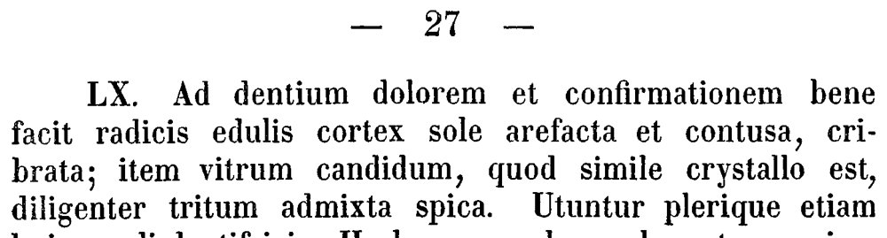

# Une notice commence-t-elle par « contre la douleur de… » ?

**Les ouvertures botaniques du Voynich ne permettent pas de lire cette formule avec les règles testées.** Dans les 63 ouvertures d’apprentissage où les trois premiers mots font l’accord des deux transcriptions et des deux découpages, aucun couple premier/troisième mot ne revient sur deux bifeuillets. Une règle moins exigeante a produit sept prédictions sur d’autres cahiers. Deux mots restaient incertains, les cinq autres ont contredit la prédiction. La forme la plus fréquente au troisième rang, `daiin`, aurait donné une réussite sur les mêmes cinq places. [Annonces écrites avant vérification](PREDICTIONS.json) · [Résultats](RESULTATS.json)

## Ce qu’écrivait un scribe

Sur le dernier verso du MS.709 de Wellcome, copié en Italie du Nord à la fin du XVe siècle, six recettes occupent la colonne droite, à la suite d’un traité de Jean de Roquetaillade. Au bas de la colonne, un pied-de-mouche bleu précède l’intitulé en encre pâle. On lit *Ad dolorem dentiu[m]*, « contre la douleur des dents ». À la ligne suivante, un pied-de-mouche rouge et le signe abrégé de *Recipe* ouvrent le texte de la prescription en encre sombre. Le premier ingrédient est *piretri*, du pyrèthre. Ici, une rubrique nomme le mal. La prescription commence par un impératif et le nom d’un ingrédient. Les deux rôles sont rendus visibles par la disposition et les couleurs. [Notice de Wellcome, MS.709, f. 30v](https://wellcomecollection.org/works/pg4yybx3) · [Folio entier](https://wellcomecollection.org/works/pg4yybx3/items?canvas=64)

![La rubrique pâle Ad dolorem dentiu[m] et le début de prescription au pied-de-mouche rouge.](wellcome-709-f30v.jpg)

Chez Scribonius Largus, auteur du Ier siècle, les préparations 1 et 53 ouvrent respectivement sur *Ad capitis dolorem* et *Ad dentium dolorem*. Le nom du mal apparaît au troisième rang. Le manuscrit italien place le même nom au deuxième rang pour les dents. Ces deux documents témoignent d’une pratique d’écriture à des dates différentes. Nous n’avons pas identifié un lien de copie entre la recette 53 et le témoin italien. [Recette 1](https://latin.packhum.org/loc/1011/1/1) · [Recette 53](https://latin.packhum.org/loc/1011/1/11)

## Épreuve sur le latin chiffré

Les 271 numéros proviennent de l’édition de Georg Helmreich, Leipzig, 1887. Le programme extrait les trois premiers mots du texte édité de chaque recette. La 169 se termine sur une lacune après deux mots. L’OCR donne `dolorein` au §5, corrigé avant le calcul d’après la seconde édition. Sur 271 entrées, 64 commencent par *ad* et 11 suivent exactement *ad X dolorem*. [Ouvertures extraites](LATIN.json) · [Édition informatisée](https://github.com/lascivaroma/additional-texts/blob/master/data/phi1011/phi001/phi1011.phi001.lascivaroma-lat1.xml)

Chaque mot latin reçoit un code opaque stable tiré au hasard. Les recettes 1 et 53 servent d’amorces et sont exclues du score. Prévoir *dolorem* après le seul code de *ad* réussit 9 fois sur 62 dans l’édition Helmreich. Exiger aussi le code de *capitis* ou de *dentium* réussit 2 fois sur 2, aux recettes 5 et 60. **Une seule des deux réussites se maintient dans les deux éditions vérifiées.** Au §60, la page imprimée de 1887 donne bien *dolorem* ; le texte de PHI donne *candorem*, « blancheur ». Le texte décrit un dentifrice, et la différence change l’indication. Les autres numéros du recueil n’ont pas fait l’objet d’une collation intégrale entre éditions. [§5 dans PHI](https://latin.packhum.org/loc/1011/1/1) · [§60 dans PHI](https://latin.packhum.org/loc/1011/1/12) · [Helmreich, page 27](https://archive.org/details/cuascriboniilarg00scri/page/27/mode/1up)



Un contrôle technique complémentaire remplace chaque lettre par un symbole secret. La recette 1 suffit à retrouver 12 correspondances. En demandant que le deuxième mot puisse être l’un des six génitifs latins annoncés, le modèle prédit exactement le troisième mot de neuf préparations sur dix dans l’édition Helmreich. La recette 119 est un faux accord. Le §60 devient également une erreur si l’on retient *candorem*. Le vocabulaire et les exemples avaient été reconnus dans le texte latin avant cette simulation. La même clé par mots entiers permet aussi de retrouver *dentium* en troisième position dans l’intitulé italien quand les deux autres codes échangent leurs places. Ces contrôles vérifient une formule déjà connue et les limites d’un mot d’appel tel que *ad*. [Code et règles](recettes.py)

## Application aux pages réservées du Voynich

Le calcul porte sur le début des paragraphes de prose signalés par `<%>` dans les deux transcriptions. On arrête la lecture au premier obstacle ou saut marqué, et l’on exige l’accord entre blancs incertains réunis et séparés. Les cahiers A–C et O fournissent l’apprentissage. Les cahiers entiers D–G et S fournissent la réserve. Une page déjà reproduite dans une autre étude demeure historiquement connue de l’équipe. Les mots à prévoir dans cet essai ont été isolés par programme et n’ont été dépouillés qu’après l’enregistrement des annonces. Deux transcriptions d’un même objet ne constituent pas deux observations physiques. [Protocole daté dans le dépôt](PROTOCOLE.md)

| Ensemble | Famille | Débuts signalés par les deux transcriptions | Les 3 premiers mots font accord |
|---|---|---:|---:|
| Apprentissage | Grandes plantes | 89 | 56 |
| Apprentissage | Fragments et récipients | 17 | 7 |
| Réserve | Grandes plantes | 123 | 61 |
| Réserve | Fragments et récipients | 27 | 12 |

Dans le modèle par signes, les unités EVA simples ou groupées peuvent donner une lettre, puis une ou deux lettres dans une seconde expérience. *Ad* ne convient à aucune des 63 ouvertures complètes avec l’initiale conservée. Retirer la potence initiale permet une amorce *ad* dans chaque largeur de table, mais le génitif suivant échoue aussitôt. Le modèle ne produit donc aucune clé pour prédire *dolorem*. Dans le code par mots entiers, aucun couple premier/troisième ne se répète entre deux bifeuillets de l’apprentissage. Le renversement observé dans le manuscrit italien n’a fourni aucun appel dans la réserve. Les cinq mots que l’on a effectivement pu ouvrir proviennent tous d’un diagnostic plus permissif, transférant le troisième mot associé à un premier mot identique. Il ne suffit pas pour attribuer des valeurs en latin.

| Lieu | Premier mot | Troisième mot annoncé | Observé |
|---|---|---|---|
| f100r.12 | `pcheol` | `sols` | `qocpheeckhy` |
| f101r.1 | `pcheol` | `sols` | incertain |
| f36v.5 | `tchor` | `chor` | `daiin` |
| f40r.8 | `ksheo` | `choldshy` | `dar` |
| f45r.8 | `tchol` | `shor` | `qodaiin` |
| f52v.1 | `pchor` | `qotor` | incertain |
| f52v.7 | `pcheol` | `sols` | `cthor` |

La rotation des troisièmes mots à l’intérieur de la face ne fait varier le score sur aucune face parmi ces appels. Ce contrôle local a donc peu de pouvoir. L’essai vise ces deux ordres de mots au début d’un paragraphe, avec les bornes et les signes prévus. Il laisse ouverte la question de maladies ou d’ingrédients mentionnés ailleurs dans la notice, sous une autre grammaire ou une autre graphie.

## La rubrique dentaire permet-elle de prédire la plante ?

Après la première vérification, une annonce supplémentaire a été enregistrée. À partir du *piretri* de la recette italienne on a prédit *pyrethrum* ou l’une de ses flexions dans la préparation 60 de Scribonius, dont le début en *Ad dentium dolorem* dans Helmreich avait motivé la sélection. Le corps de cette recette ne donne aucune des formes annoncées dans ses 123 groupes alphabétiques. La forme *pyrethri* figure dans six autres numéros (9, 55, 69, 153, 155, 156), dont le 55 concerne les dents. Une ressemblance avec une recette voisine ne réalise pas l’annonce. La variante *candorem* constatée ensuite touche au motif même de la sélection de la recette 60. Cet essai ne permet donc aucune conclusion générale sur les remèdes contre une même douleur à travers les siècles. [Annonce sur l’ingrédient](REMEDE-PREDICTION.md) · [Vérification et inventaire](REMEDE-RESULTAT.json)

## Reproduire

Depuis ce dossier, les deux premières commandes ci-dessous recalculent les annonces et les résultats avec le fichier d’ouvertures fourni. Les commandes suivantes régénèrent le relevé latin et le contrôle de l’ingrédient à partir du XML. L’empreinte du XML est vérifiée avant toute extraction. Le recadrage de Wellcome provient de la région `2310,4650,1710,555` du canevas 64. Le recadrage de l’imprimé provient de l’image TIFF `0037` de l’archive des photographies du volume, rectangle `(197,95,1757,515)`. [Image source de Wellcome](https://iiif.wellcomecollection.org/image/b18934183_MS_709_0064.JP2/2310,4650,1710,555/1100,/0/default.jpg) · [Numérisation de l’imprimé](https://archive.org/details/cuascriboniilarg00scri/page/27/mode/1up)

```sh
python3 -B recettes.py predire
python3 -B recettes.py verifier
curl -fsSL https://raw.githubusercontent.com/lascivaroma/additional-texts/master/data/phi1011/phi001/phi1011.phi001.lascivaroma-lat1.xml -o /tmp/scribonius-helmreich.xml
python3 -B recettes.py source /tmp/scribonius-helmreich.xml
python3 -B remede.py /tmp/scribonius-helmreich.xml
```
