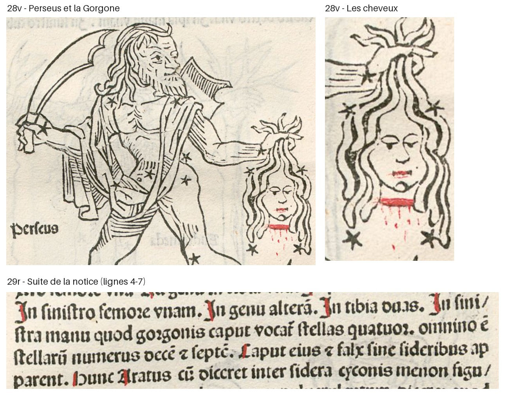

# Un nom de constellation, une partie du corps et quatre étoiles

**Dans l’Hygin imprimé à Venise en 1482, quatre étoiles dessinées ont permis de prévoir un nombre et son référent dans la prose de la page suivante.** Persée tient de la main gauche une tête à la chevelure longue. Deux étoiles se trouvent dans la partie haute de la chevelure et deux à ses extrémités inférieures. Une cinquième marque est sur le poignet du porteur. Avant d’ouvrir le recto suivant, nous avons annoncé quatre étoiles sur la tête de la Gorgone et aucune sur la tête propre de Persée. Le latin donne bien *stellas quatuor* dans la partie de la figure appelée « tête de la Gorgone ». La phrase suivante précise que la tête du porteur et la faucille apparaissent sans étoiles. [Prédiction avant ouverture](GORGONE-AVANT.md) · [Détail des quatre étoiles et phrase sur le recto suivant](quatre-etoiles.jpg) · [Gravure, f. 28v](https://www.digitale-sammlungen.de/view/bsb00054123?page=62) · [Texte, f. 29r](https://www.digitale-sammlungen.de/view/bsb00054123?page=63)

La distinction peut se relire sur le livre même. Le nom *Perseus* est imprimé contre le personnage, à gauche de sa hanche. L’énumération attribue séparément une étoile à sa main gauche, celle avec laquelle il est dit tenir la tête. Un peu plus loin, elle attribue les quatre étoiles à ce qui est appelé la tête de la Gorgone, à cette même main. La phrase qui met fin au décompte donne dix-sept étoiles. Après l’observation sur la tête et la faucille sans étoiles et une discussion sur Aratos, le texte entame une autre constellation. [F. 29r, original](https://api.digitale-sammlungen.de/iiif/image/v2/bsb00054123_00063/full/1450,/0/default.jpg)

## Deux prédictions antérieures et leurs erreurs

| Passage réservé | Annonce | Résultat |
|---|---|---|
| Du f. 27v au f. 28r | Un dessin nommé *Perseus*, ce nom dans les cinq premiers mots de la notice, une étoile indiquée et dessinée sur la tête de Persée | Le dessin et le premier mot donnent *Andromeda*. *Persei* vient en sixième position, dans une expression qui situe Andromède par rapport à la tête de Persée. Les quatre attributions spécifiques à Persée échouent sur cette page. |
| Du bas de 28r au début de 28v | Après *in sinistro cubito vel in*, prévoir *manu unam*, avec « une » comme pronostic secondaire | La suite est *brachio unam. In manu alteram*, « au bras, une. À la main, une autre ». Le premier mot et la paire exacte échouent, la quantité prévue et le report direct du paragraphe sont vérifiés. |

Le premier pari exploitait un index moderne où l’entrée « Persée » suit « Cassiopée » dans le tableau. L’ordre des entrées de ce tableau diffère de celui des pages imprimées. Nous avions fixé le prochain recto comme cible. Retrouver finalement Persée sur 28v ne récupère pas le pari de 28r. Le succès sur la Gorgone est une épreuve ultérieure qui part de la photographie de la figure réellement trouvée sur 28v. Les décomptes partageant une notice ne forment pas des essais indépendants. [Premier pari](AVANT.md) · [Prédiction mot à mot](SUITE-AVANT.md) · [Trois figures photographiées dans leur ordre physique](trois-figures.jpg)

## Ce que désigne le nom près du dessin

Sur f. 27v, la petite inscription à côté du trône et le début de la notice donnent le nom de Cassiopée. La prose parle ensuite d’une étoile à la tête et d’une à chaque épaule. Sur f. 28r, Andromède est liée entre deux arbres. Une étoile est gravée dans la chevelure et une sur chaque épaule. Le corps du texte les recense et décrit la même étoile comme le nombril de Pégase et la tête d’Andromède. Dans ce témoin, une étoile a donc deux repères corporels selon la constellation considérée. Les trois bois montrent des personnes portant des étoiles, chacun avec un nom propre différent près du dessin. Les mots pour le bras, la main, la tête ou les étoiles se trouvent dans les phrases qui précisent leurs relations. [Cassiopée, f. 27v](https://api.digitale-sammlungen.de/iiif/image/v2/bsb00054123_00060/full/1450,/0/default.jpg) · [Andromède, f. 28r](https://api.digitale-sammlungen.de/iiif/image/v2/bsb00054123_00061/full/1450,/0/default.jpg)

## Exemplaire et reproduction

Hyginus Mythographus, *Poeticon astronomicon*, Venise, Erhard Ratdolt, 1482, Munich, Bayerische Staatsbibliothek, 4 Inc.c.a. 234, BSB-ID bsb00054123. Il s’agit d’un imprimé astronomique du XVe siècle, transmission d’un texte antique. La présente épreuve repose sur une seule édition et des lectures par un agent IA. Elle mesure localement ce qu’un dessin permet de prévoir dans une notice dont la langue est connue. Elle ne détermine aucune relation historique entre les deux livres et ne fournit pas une traduction du Voynich. [Notice et fac-similé](https://www.digitale-sammlungen.de/view/bsb00054123) · [Manifeste IIIF et marque du domaine public](https://api.digitale-sammlungen.de/iiif/presentation/v2/bsb00054123/manifest)

Pour reproduire les deux planches, télécharger les quatre vues de largeur 1 450 pixels en remplaçant NNNNN par 00060, 00061, 00062 et 00063 dans `https://api.digitale-sammlungen.de/iiif/image/v2/bsb00054123_NNNNN/full/1450,/0/default.jpg`. Les nommer `voy-hygin-1482-60.jpg` à `voy-hygin-1482-63.jpg` dans un même dossier, puis lancer `python3 -B planche.py DOSSIER`. Le programme vérifie les quatre empreintes SHA-256 avant tout découpage. La transcription harmonise u et v et développe les abréviations usuelles. [Script, cadrages et empreintes](planche.py)
