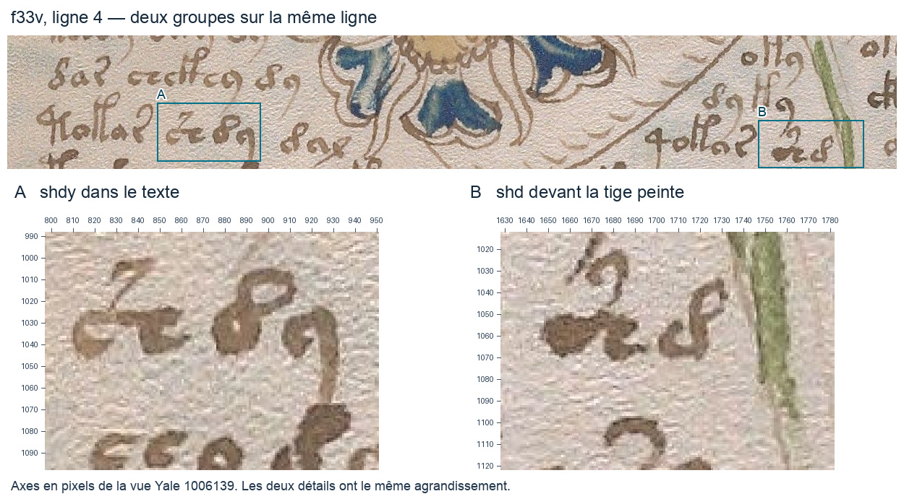

# Un scribe omet-il la finale EVA `y` devant le dessin ?

Sur **f33v.4**, la forme `shd` s’arrête juste avant une tige peinte. Quelques mots plus tôt sur la même ligne, `shdy` porte une finale dont le tracé déborderait sur cette tige si on le déplaçait sans le déformer. **À l’échelle de l’herbier, la prédiction de raccourcissement échoue.** Sur les 13 sites permettant une comparaison entre formes d’une même famille sur la même face, 5 portent la forme courte, contre 8,1 attendues si les positions étaient échangeables. Cette étude renseigne la disposition de l’écriture autour des images. Le sens de `shd` et de `shdy` demeure inconnu.

## La ligne de f33v

Les deux transcriptions lisent, dans l’ordre, `tokar.shdy.dal`, puis `qokar.shd` après une première interruption. Une seconde interruption suit `shd`. Sur la photographie, le premier tronçon est à gauche d’un grand motif floral. Le deuxième est entre ce motif et une tige étroite, exactement à gauche de cette tige. La photographie permet de voir la finale du premier groupe, la fin du second et le contour du dessin sur une seule ligne d’écriture. Le site a été choisi **après** le calcul. C’est l’unique comparaison informative à l’intérieur d’une même ligne, et le contrôle photographique porte sur la géométrie. [Vue Yale no 1006139](https://collections.library.yale.edu/catalog/2002046?child_oid=1006139) · [Cliché natif](https://collections.library.yale.edu/iiif/2/1006139/full/full/0/default.jpg)

Dans le premier groupe, le bord droit de la boucle supérieure du `d` est vers x = 912 et le bord droit du `y` vers x = 932. Ajouter cette finale prolonge donc le groupe d’environ **20 pixels**. Dans le second, la boucle du `d` arrive vers x = 1733. À la hauteur où se placerait le corps du `y`, le premier trait de la tige est vers x = 1742–1747. Cela laisse **environ 9–14 pixels** au-delà de l’extrémité de la boucle. Un gabarit rigide, reporté en alignant les deux `d`, dépasserait donc de plusieurs pixels le bord de la tige. Les abscisses sont des repères visuels sur la vue de 2 871 × 3 769 pixels, avec quelques pixels d’incertitude. Le signe final descend, le dessin est incliné et l’encre se diffuse dans le parchemin. Le scribe pouvait resserrer ou déplacer le groupe. La proximité seule ne dit ni s’il voulait tracer un `y`, ni dans quel ordre texte et peinture ont été exécutés.

## Champ et comparaison

Les feuillets **10, 11, 15 et 96**, recto et verso, et la famille initiale `cth/cthy` ont été exclus avant le comptage. Unité principale, la famille comprend une base X d’au moins deux unités de transcription EVA et cette base suivie d’un seul `y`. La base doit se terminer par un autre signe, ce qui empêche les doubles attributions. Les deux formes doivent être attestées dans le champ correspondant. Unités EVA et limites de mots sont des conventions d’édition. [Protocole avant extraction](PROTOCOLE.md) · [Critères de sensibilité ajoutés après le premier comptage](SENSIBILITE.md)

L’herbier comprend **1 484 lignes de prose P0 communes** aux éditions IT et ZL, après exclusions. IT y compte 619 marques d’interruption et ZL 622. L’ordre ou le nombre des marques diffère sur 23 lignes. Les 1 461 lignes admises en comptent 583. Les marques `<->` et `<~>` signalent selon IVTFF une interruption attribuée à un dessin, la seconde indiquant aussi un décalage vertical. Seules les photographies effectivement inspectées permettent de caractériser l’obstacle, sa distance et la place disponible. [Règles IVTFF, tableau 11](../../../voynich_20261028/data/IVTFF_format.txt) · [Édition IT](../../../voynich_20261028/data/IT2a-n.txt) · [Édition ZL](../../../voynich_20261028/data/ZL3b-n.txt)

Pour chacun des tronçons, la lecture IT à séparations incertaines jointes a été alignée aux trois autres lectures (IT séparé, ZL joint, ZL séparé). Seules les correspondances présentes dans **tous** les alignements maximisant le nombre de mots identiques dans le bon ordre et conservant le même statut de bord ont été retenues. Sur 10 472 jetons de référence, 19 étaient illisibles ou annotés, 2 234 sans appariement identique imposé et 7 avec une position de bord divergente. Restent **8 212 jetons**, dont **2 859** dans les **162 familles** attestées sous les deux formes, sur 120 faces. Les quatre traitements examinent le même manuscrit.

| Position dans les 162 familles | Courte | Avec y |
|---|---:|---:|
| Juste avant une interruption | 101 | 77 |
| Juste après une interruption | 116 | 33 |
| Dernier mot d’une ligne | 202 | 149 |
| Premier mot d’une ligne | 211 | 63 |
| Intérieur strict d’un tronçon | 1 275 | 665 |

Un mot seul dans son tronçon peut appartenir à deux catégories de bord. Un témoin intérieur a de l’écriture de part et d’autre dans son tronçon. Les marges brutes mélangent les familles et les faces. Pour le test, chaque occurrence au bord est comparée aux occurrences intérieures **de la même famille sur la même face**. Une strate apporte de l’information si elle comporte les deux positions et les deux formes.

| Épreuve | Strates informatives | Courtes au bord / occurrences au bord | Courtes à l’intérieur / occurrences intérieures | Courtes attendues au bord | p unilatérale (excès de courtes) |
|---|---:|---:|---:|---:|---:|
| Avant l’interruption, herbier | 11 | 5 / 13 | 15 / 18 | 8,10 | 0,9880 |
| Avant, feuillets pairs | 6 | 3 / 8 | 10 / 11 | 5,35 | 0,9938 |
| Avant, feuillets impairs | 5 | 2 / 5 | 5 / 7 | 2,75 | 0,8750 |
| Après l’interruption, herbier | 4 | 3 / 6 | 5 / 6 | 4,00 | 0,9531 |
| Fin de ligne hors interruption, herbier | 23 | 5 / 24 | 36 / 45 | 13,57 | 0,99998 |
| Avant, autres sections de prose réunies | 5 | 2 / 9 | 14 / 23 | 5,85 | 1,0000 |

Le test fixe les effectifs court/long et bord/intérieur dans chaque strate. La probabilité publiée est celle d’observer **au moins** ce nombre de formes courtes avant la marque sous l’hypothèse d’échangeabilité. Le résultat se trouve dans le sens opposé à la prédiction, dans les deux moitiés de l’herbier. Aux fins de ligne sans interruption, ce sont même les **formes longues** qui dominent dans ces comparaisons (19 sur 24). Ces fins de ligne constituent une autre position du scribe, sans hypothèse sur une contrainte de place identique à celle d’un dessin. Les autres sections de prose totalisent 2 315 lignes communes, dont 2 269 avec la même suite de marques, et 256 familles sur 17 134 jetons stables. Les lignes apparentées, les habitudes des scribes et les positions syntaxiques peuvent limiter l’échangeabilité.

## Les onze comparaisons qui déterminent le résultat principal

| Face et famille | Juste avant l’interruption | Intérieurs de la même face |
|---|---|---|
| f2r · daiin | .7 daiiny, .10 daiin | .1 et .13 daiin |
| f4v · cheor | .2 cheory | .13 cheor |
| f8v · chor | .3 chory | .15 chor |
| f23r · ol | .9 oly | .5 ol (deux fois), .7 ol |
| f29v · cthod | .6 cthod | .8 cthody |
| f33v · shd | .4 shd | .4 shdy |
| f34r · chdal | .3 chdaly | .12 chdal |
| f40r · or | .9 or | .5 et .6 or, .11 ory |
| f41v · okal | .3 okaly | .6 okal |
| f42v · chol | .3 chol, .14 choly | .3, .12 et .15 chol |
| f47v · chor | .2 chory | .5 chor |

Les formes longues devant une interruption sur f4v.2, f8v.3 ou f47v.2 ont autant de valeur pour juger la prédiction que la forme courte sur f33v.4. Une étude géométrique élargie devrait mesurer systématiquement la largeur disponible devant chaque type de contour, y compris dans les cas contraires. Les sites figurent dans l’inventaire, avec le rang du mot dans chaque lecture. [Toutes les occurrences des familles retenues](occurrences.tsv) · [Toutes les marges par famille](resultats.json)

## Contrôles et puissance

- En ôtant les mots seuls dans un tronçon qui cumulent deux statuts de bord, on retrouve 5 courtes sur 12 avant la marque pour 7,6 attendues, p = 0,9791.
- En imposant la même famille sur la **même ligne**, il reste uniquement f33v.4, avec une courte au bord pour 0,5 attendue, p = 0,5.
- En exigeant l’identité de tous les mots de toute la ligne dans les quatre traitements, 449 lignes passent. Trois strates sont informatives, avec 1 courte sur 3 pour 1,5 attendue, p = 0,875.
- Sur les bases d’une seule unité EVA, plus proches de `cth` en longueur, les six paires admissibles ont pour bases `d`, `l`, `o`, `r`, `s` et `sh`. Deux strates sont informatives, avec 0 courte sur 2 avant la marque pour 1 attendue, p = 1.
- Aux marges observées, le seuil unilatéral de 5 % exige au moins **12 courtes sur 13**. Si la cote de forme courte avant la marque était multipliée par deux, la probabilité de détecter cet effet sous ce modèle serait de **12,2 %**. Elle atteindrait **51,7 %** pour une cote multipliée par cinq. Un contrôle artificiel qui place le maximum de courtes autorisé par les marges (13 sur 13) donnerait p = 0,00132. Une pratique occasionnelle demeure donc difficile à détecter.

## Reproduction

Depuis ce dossier, lancer `python3 mesurer.py`, puis `python3 verifier.py`. Le second programme compare l’alignement à une énumération indépendante de toutes les solutions sur 14 641 couples de courtes séquences et recalcule depuis le TSV, par tirage explicite des positions possibles, la probabilité exacte **4 047 / 4 096**. Le fichier de résultats et la table des occurrences ont respectivement pour empreintes SHA-256 `2e481a6e6c6c28fcacb4f85a4c4e0e456fb2cb7ced4f1f02792d5996a18a3ada` et `d9312430572b2a144cf00ca2873ecffd9e0691f7080b5d8e8f5a29319bc4fae7`. Le contrôle photographique se reproduit avec `python3 photo_f33v.py chemin/vers/1006139.jpg`, Pillow et une police DejaVu Sans ou Arial. L’empreinte du cliché source est `41b148c40e9cf73c63044c5415d3c2bbeebffc20153a36762f35e8134da42941`.
