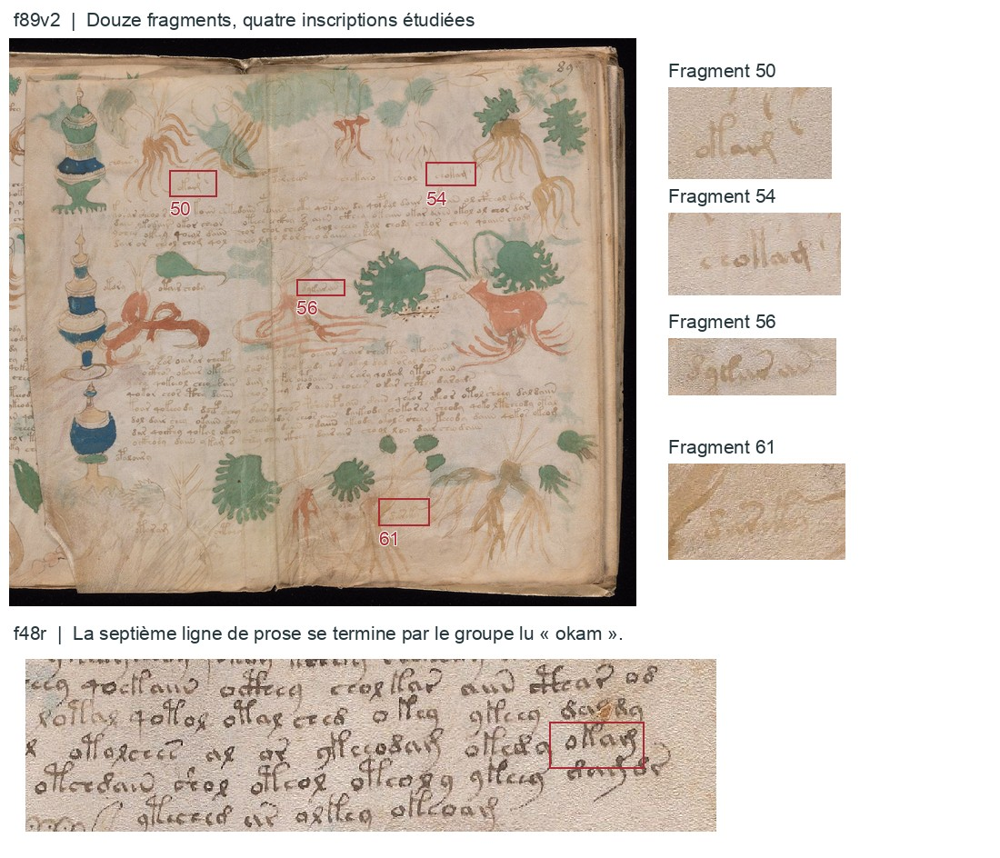

# Où conduit une légende lorsque quatre dessins ont une grande plante proposée ?

Sur f89v2, deux des quatre fragments du catalogue ont un mot lisible de la même manière dans les deux éditions, `okam` et `chokam`. **Aucun ne désigne par une reprise exacte la page de la plante qui lui est associée.** L'accord le plus net, `okam`, conduit à une page concurrente. Même avec une ou deux unités variables au début ou à la fin, chacun des quatre couples du catalogue marque zéro point dans chaque édition prise séparément. [Matrice des douze fragments](RESULTATS.json) · [Protocole](PROTOCOLE.md)

| Fragment et rangée | Groupe en H et ZL | Grande plante selon le catalogue | Où conduit la forme exacte dans les quatre grandes pages ? |
|---|---|---|---|
| 50, rangée 1 | okam | f10v | f48r.7 |
| 54, rangée 1 | chokam | f48v | Aucune |
| 56, rangée 2 | dydariin / dykaran | f24r | Aucune dans chacune des éditions |
| 61, rangée 3 | dareky / daseky | f48r | Aucune dans chacune des éditions |

Le scribe a disposé cinq petites plantes dans le premier rang, trois dans le deuxième et quatre dans le dernier. Le 50 est la première plante en haut, près du grand récipient. Son inscription est sous le faisceau de racines, décalée vers sa droite. Le 54 occupe l'extrémité opposée, sa légende se lit à gauche des racines. Au 56, l’inscription passe près d’un trait du dessin. Pour le 61, le mot très pâle est entre les deux dernières formes souterraines. Le registre antérieur classe ces quatre attaches comme faibles. Ces positions sur la photo ne suffisent pas à choisir un organe ni à établir les quatre identités de plantes. H, ZL et deux anciennes lectures donnent `okam` au 50, tandis que Grove transcrit `okaim`. On distingue le cercle initial et la haute traverse suivante. La fin de cette petite inscription est moins noire que sur f48r. Les divergences de la rangée du bas empêchent de trancher certaines lettres. [Planche sur le parchemin](lectures.jpg) · [Ancienne collation, L1.1 et L3.4](https://www.voynich.nu/q15/f089v2_tr.txt) · [Catalogue des rapprochements](https://www.voynich.nu/q15/#f89v2)

La prose P0 fournit respectivement 42, 103, 89 et 62 mots concordants pour f10v, f48v, f24r et f48r. Six des douze fragments possèdent au moins un mot concordant. Le 55 possède les deux groupes `otair chody`. Son second groupe figure à f48v.3 et une forme plus longue `otchody` à f48v.2. Cette page est celle que le catalogue rapproche du **54**. Le `okam` de f48r.7 reçoit également le mot du 54 si l'on autorise la perte d'un `ch` initial. Le meilleur mot exact du 50 et le meilleur mot ressemblant du 54 renvoient ainsi à la même ligne. Aucune des quatre inscriptions attendues n'a d'accord exact dans les deux premières lignes. La comparaison principale porte sur les lignes P0. Elle omet trois lignes centrées ou ferrées à droite à f24r et f48r. On y lit entre autres `okeoam` dans la dernière ligne de f48r. Ces trois lignes ne présentent aucune des quatre légendes exactes. [Lignes et toutes les sensibilités](RESULTATS.json)

Sur les 24 bijections, 6 affectent le 50 à f48r et donnent un point, les 18 autres donnent zéro comme le catalogue. Pour le début mobile, 6 affectations donnent deux points, 6 donnent un point et 12 donnent zéro. Toutes les affectations sont descriptivement au moins aussi favorables que celle du catalogue. Deux grandes plantes sont les deux faces de f48 et l'on compare des sections, mains et longueurs différentes. Le registre avait déjà servi à l'étude des cent premières positions sur un ensemble plus large. Le présent test compare les quatre grandes pages d'un seul panneau entre elles, les douze légendes concurrentes du panneau, et les blocs de prose sous les rangées. [Registre et résultats antérieurs](../../2026-11-18-noms-dans-les-notices/RAPPORT.md)

## Masquer les légendes

Le paragraphe sous la rangée du haut fournit 24 paires distinctes de mots contigus concordants, les deux paragraphes sous la rangée médiane 42. Aucune paire du haut n'apparaît sur les grandes plantes f10v et f48v proposées pour les fragments de cette rangée. Aucune paire du milieu ne revient sur la grande plante f24r proposée pour le 56. Une seule paire se retrouve dans toute la comparaison, `cthy daiin` à f89v2.18 sous la rangée **du milieu**, et à f10v.2, proposée pour le premier fragment **du haut**. Le rapport intersection/union vaut 1/73 pour cette seule cellule, zéro partout ailleurs. Sur les trois cibles évaluables, la règle donne donc un choix contraire au catalogue et deux abstentions. Pour f48r, il n'y a aucun paragraphe sous le fragment 61 sur f89v2 à comparer. [Mots et quantités de texte](RESULTATS.json)

## Le mot de la page concurrente ferme fréquemment une ligne

Après avoir constaté que `okam` se trouve au dernier mot de f48r.7, nous avons fixé une épreuve sur les 1 525 autres lignes P0 des pages de plantes, en écartant les quatre grandes pages ci-dessus. Les deux éditions et les deux traitements des blancs retrouvent `okam` avec le même statut interne ou final sur dix lignes, et **sept fois comme dernier mot**. En prenant chaque édition séparément, la proportion est de 10/13 chez Takahashi et 9/12 chez Zandbergen–Landini. Les autres mots en `m` occupent eux aussi souvent le dernier emplacement, 194/325 en H, 161/276 en ZL joint et 161/281 en ZL séparé. Tous mots simples confondus, la fin de ligne représente environ 14 % des positions lisibles. C’est une limite concrète lorsqu'on veut se servir de cette forme comme d'un nom distinctif. Une prédilection pour la fin de ligne laisse ouverte sa fonction lexicale. [Protocole fixé après la découverte de f48r.7](CONTROLE-FIN.md) · [Tous les emplacements](POSITION-OKAM.json)

## Reproduction

Exécuter `python3 -B comparer_fragments.py` et `python3 -B position_okam.py` dans ce dossier. La planche se refait avec Pillow et `python3 planche.py panneau.jpg notice.jpg` à partir des JPEG Yale de f89v2 en largeur 2 400 et de f48r en largeur 1 800. Les rectangles de prélèvement se trouvent dans le programme. [JPEG du panneau](https://collections.library.yale.edu/iiif/2/1006234/full/2400,/0/default.jpg) · [JPEG de la grande plante](https://collections.library.yale.edu/iiif/2/1006168/full/1800,/0/default.jpg)
