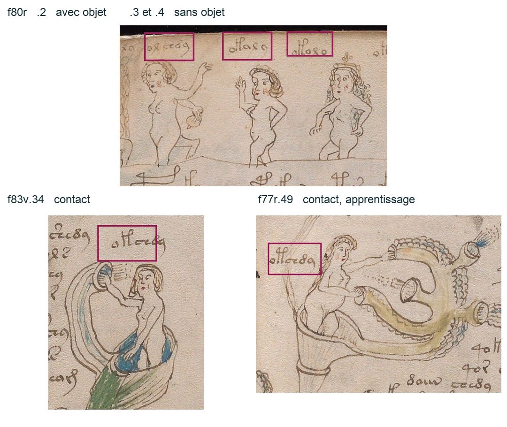

# Les mains et les légendes des personnages

**Sur f80r, une personne tient une petite forme arrondie et ses deux voisines ont les mains libres. Les trois légendes commencent par `o`.** C’est la seule face de réserve où les deux gestes sont observables sous des inscriptions transcrites de manière concordante. Elle permet de vérifier directement si l’initiale annoncée différencie les gestes à l’intérieur d’une même scène. [Yale, f80r](https://collections.library.yale.edu/iiif/2/1006218/full/full/0/default.jpg)

## Prédiction et épreuve

Un lecteur IA a observé les figures dont la catégorie éditoriale est Ln dans le cahier 13. Il a couvert les boîtes de texte du visualiseur et conservé les numéros de locus. Il a noté le contact visible entre une main et un objet, l’absence de contact lorsqu’il pouvait suivre les deux mains, et l’incertitude dans les autres cas. Pour les dix légendes doubles de f75v, l’unité est le personnage, suivi de ses deux lignes de légende. Le premier mot n’entre dans le calcul que si les transcriptions de Takahashi et de Zandbergen–Landini concordent sous les deux conventions d’espacement. [Cartes masquées](cartes-masquees.jpg) · [Cotation, descriptions et coordonnées originales](COTATION.json) · [Protocole](PROTOCOLE.md) · [Précision sur les lignes regroupées](PRECISION.md)

| Étape | Figures étiquetées | Contact visible | Absence de contact visible | Incertain | Avec une lecture admissible |
|---|---:|---:|---:|---:|---|
| Apprentissage, bifeuillet 77/82 | 21 | 7 | 3 | 11 | 5 contacts et 2 sans contact |
| Réserve, bifeuillets 75/84, 76/83 et 79/80 | 32 | 2 | 5 | 25 | 2 contacts et 4 sans contact |

Les 53 objets couvrent huit faces. Le bifeuillet 78/81 n’offre aucune légende Ln. Cinq objets de l’ensemble n’avaient pas de boîte appariée à une légende du registre ; ils sont compris dans la colonne « Incertain ». D’autres ont une main cachée par une figure, une déchirure ou de la peinture. Si une main se confond avec un jet d’eau, une vague ou la silhouette voisine, la proximité seule ne suffit pas. Plusieurs de ces pages avaient déjà été étudiées dans le projet. Les boîtes de mots appariés sont masquées sur les cartes et de petits résidus d’écriture peuvent rester au-delà de leur contour.

Dans l’apprentissage, l’initiale `o` est présente près de 5 contacts sur 5 et de 1 figure sur 2 sans contact. C’est la seule initiale répondant à la règle déposée. Les cinq premiers mots entiers des légendes proches d’un contact sont tous différents ; aucun n’atteint le seuil de deux contacts nécessaire pour le proposer à la réserve. La cotation et la prédiction d’une fréquence de `o` supérieure près des contacts ont été enregistrées séparément. [Prédiction et lectures d’apprentissage](PREDICTION.json)

| Bifeuillet de réserve | Face et légendes | Contacts commençant par o | Sans contact commençant par o |
|---|---|---:|---:|
| 75/84 | f75v, f84r | 0 admis | 0/2 |
| 79/80 | f80r | 1/1 | 2/2 |
| 76/83 | f83v | 1/1 | 0 admis |
| Ensemble | Quatre faces | **2/2** | **2/4** |

À f80r, la personne qui porte le petit objet a pour étiquette `olchdy`. Les deux voisines ont les étiquettes `okaly` et `okolo`. À f83v.34, une autre personne touche de la main l’ouverture bleue d’une forme recourbée ; l’étiquette près de la tête est `okchdy`. Sur 75/84, les deux inscriptions sans contact admissibles commencent par `d`. L’écart brut de 50 points de pourcentage entre les gestes peut ainsi être produit par la distribution des graphies entre les pages. En permutant les étiquettes uniquement au sein de chaque face, chaque permutation possible donne exactement le nombre de rencontres observé entre `o` et le geste (p unilatéral = 1). Une seule face contribue au contraste. [Photographie de f83v](https://collections.library.yale.edu/iiif/2/1006225/full/full/0/default.jpg) · [Résultats détaillés](RESULTATS.json)

Les deux mots `olchdy` et `okchdy` de la réserve diffèrent par une seule unité. Cette ressemblance a été remarquée après l’ouverture des étiquettes. Elle a fait l’objet d’une nouvelle prédiction, puis d’une recherche sur le manuscrit entier. [Résultats du nouveau test](paire/RAPPORT.md)

## Reproduction

Dans ce dossier, `python3 -B verifier.py apprendre` reproduit la prédiction et `python3 -B verifier.py verifier` reproduit les résultats sur la réserve. Les identifiants Ln ont été pris dans [l’inventaire existant du cahier](../../2026-11-18-baigneuses-et-conduits/corpus/INVENTAIRE.json). Pour chaque page, l’empreinte du JPEG Yale, sa taille et l’erreur de calage de l’image du visualiseur sont enregistrées dans la cotation. Sur les huit faces, le 95ᵉ centile est inférieur à 5 pixels sur les photographies natives. Le calage mesure la concordance entre les deux images. L’association entre une inscription et une figure reste un jugement visuel. La commande `python3 -B planches.py DOSSIER_JPG` régénère les trois détails à partir des originaux vérifiés. [Calcul](verifier.py) · [Préparation de la planche](planches.py)

Pour refaire les masques, utiliser les JPEG Yale de la cotation et les cartes de Voynichese des huit faces, enregistrées sous les noms f75v.json, f77r.json, etc. La commande `python3 -B masquer.py DOSSIER_JPG DOSSIER_CARTES` reproduit la planche ; l’option `--individuelles SORTIE` permet d’examiner chaque carte masquée à la taille native. Les coordonnées ont été alignées par points visuels SIFT, puis par transformation affine robuste. [Sources du visualiseur, empreintes et matrices](CALAGE.json) · [Construction des cartes](masquer.py)
