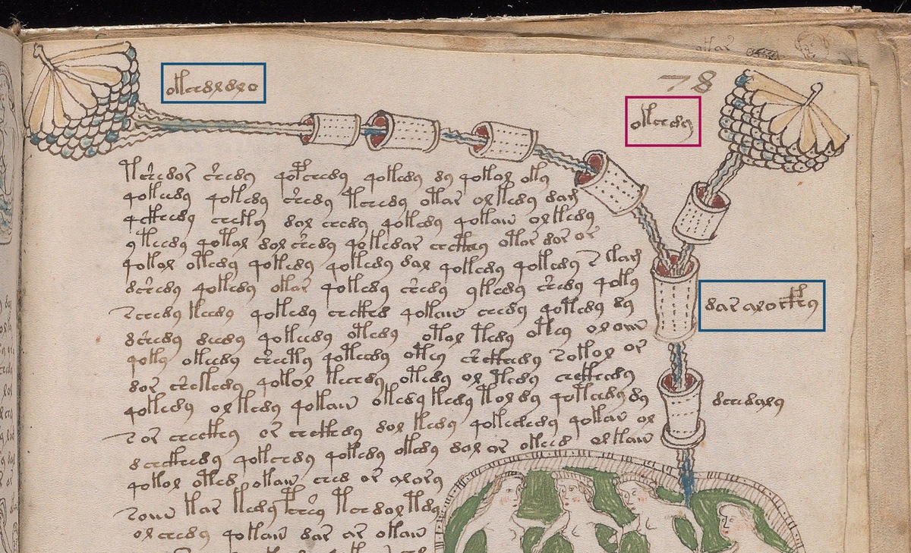

# Le même mot devant un réseau dépourvu de main voisine

**`okchdy` accompagne une main touchant une ouverture sur f83v.34. Le mot entier se retrouve à f78r.2, près d’un dispositif dessiné sans main voisine.** Sur cette autre page, l’étiquette est dans l’espace à gauche de la forme en éventail du haut à droite, au-dessus de la jonction des deux branches. Les premières figures sont plus bas, dans un bassin relié au dispositif. Sur cette même face, les deux étiquettes de dispositif les plus proches dans le registre se trouvent près du départ de la branche de gauche (f78r.1) et du cylindre où convergent les branches (f78r.44). La présence de ce mot n’exige donc pas qu’une main soit visible près de l’inscription. [Détail masqué utilisé pour la vérification](f78r-masque.jpg) · [Fac-similé de Yale, f78r](https://collections.library.yale.edu/iiif/2/1006214/full/full/0/default.jpg)

## De deux mots observés à une prédiction

La ressemblance a été repérée après lecture de la réserve du test sur l’initiale. En unités EVA, les deux mots repérés près de mains qui touchent un objet sont `o·l·ch·d·y` à f80r.2 et `o·k·ch·d·y` à f83v.34. Avant d’en chercher d’autres, nous avons prédit que le patron de cinq unités `o·X·ch·d·y` se retrouverait plus souvent près d’un contact manuel que d’une figure aux mains libres. L’espace X contient une seule unité. Les lieux déjà étudiés ne constituent pas un nouveau test. [Prédiction enregistrée](PREDICTION.md) · [Les deux mains et les étiquettes originales](../gestes-verifies.jpg)

| Locus en accord dans les quatre lectures | Mot | Attache et portée |
|---|---|---|
| f80r.2 | `olchdy` | Une main tient un petit objet. Lieu de découverte. |
| f83v.34 | `okchdy` | Les doigts touchent une ouverture bleue. Lieu de découverte. |
| f77r.49 | `otchdy` | Deux mains touchent des ouvertures. Lieu de l’apprentissage antérieur. |
| f78r.2 | `okchdy` | Mot déjà vu, sur le bifeuillet 78/81, près d’un réseau étiqueté Lt. Aucun personnage ne jouxte l’inscription. |

Les trois légendes de figures concordantes appartiennent toutes au matériau ayant servi à formuler la piste. Sur les treize figures dont le geste et le premier mot sont admis dans ces deux lots, le patron apparaît près de 3 contacts sur 7 et de 0 figure sur 6 sans contact. La prédiction posée pour de **nouvelles figures** ne rencontre aucun exemplaire concordant à tester. F78r.2 renseigne en revanche sur la spécificité du mot dans les légendes en général. Son numéro IVTFF et sa boîte ont été vérifiés en recoupant la séquence de trois étiquettes dans le visualiseur et les deux transcriptions. Les deux témoins voisins appartiennent également à la classe Lt. Aucune de ces trois étiquettes de f78r n'entre au dénominateur des mains libres. [Coordonnées et calage](COORDONNEES.json) · [Script de recadrage](photo.py)

## Légendes et texte suivi

La recherche retient les occurrences concordantes dans H et ZL, blancs faibles séparés ou joints, au même identifiant de locus. Elle porte sur 659 occurrences de mots lisibles dans les lignes d’étiquettes L* et 27 375 dans les lignes P*. Les deux éditions peuvent couvrir ou numéroter différemment certaines parties du manuscrit. Les groupes partagés sont comptés au sein de la même ligne ; une attribution à un dessin exige une vérification photographique séparée.

| Forme correspondant au patron | Occurrences dans L* | Occurrences dans P* |
|---|---:|---:|
| `olchdy` | 1 | 6 |
| `okchdy` | 2 | 15 |
| `otchdy` | 1 | 23 |
| `ofchdy` | 0 | 5 |
| `opchdy` | 0 | 17 |
| Total | **4 sur 4 loci** | **66 sur 64 loci** |

Huit autres lieux L* n’atteignent pas l’accord exigé. À f68r1.23, Takahashi lit `otcsdo` là où Zandbergen–Landini lit `otchdy`. Les sept autres apparaissent chez ZL seul à ces identifiants, à f67v2.1 et aux loci 45, 50, 90, 96, 125 et 156 du grand dépliant fRos. Le relevé conserve chaque forme et chaque convention. Ces mentions élargissent les comparaisons possibles et introduisent de l’incertitude sur les légendes que le double relevé permet d’étudier. [Corpus des occurrences et variantes](RESULTATS.json)

Parmi les 96 patrons de cinq unités avec une seconde unité libre observés en légende, huit atteignent au moins quatre occurrences. Trois en ont exactement quatre, `o·X·o·r·y`, `o·X·e·o·s` et `o·X·ch·d·y`. Parmi ces trois, seul le dernier accompagne au moins trois contacts déjà cotés. Si la position libre peut être n’importe laquelle des cinq, 14 des 524 patrons ont la même fréquence et un seul atteint ces trois contacts. En donnant comme point de départ les deux formes qui ont attiré l’attention, c’est précisément la deuxième position qui change. Ces comparaisons sont descriptives et réemploient les gestes ayant attiré l’attention sur le patron. [Effectifs et liste des patrons de même fréquence](RESULTATS.json)

Le résultat permet d’écarter une règle selon laquelle toute étiquette de ce type signalerait nécessairement un contact manuel à proximité. Il laisse ouvertes plusieurs fonctions du groupe et de ses variantes. L’échantillon ne fournit aucune traduction de la main, du geste, de l’objet ou du dispositif.

Depuis ce dossier, `python3 -B chercher.py` reproduit le dépistage et les contrôles. La commande `python3 -B photo.py /chemin/vers/f78r.jpg` régénère les planches avec et sans masquage en contrôlant l’empreinte de la photographie Yale. [Code de recherche](chercher.py)
