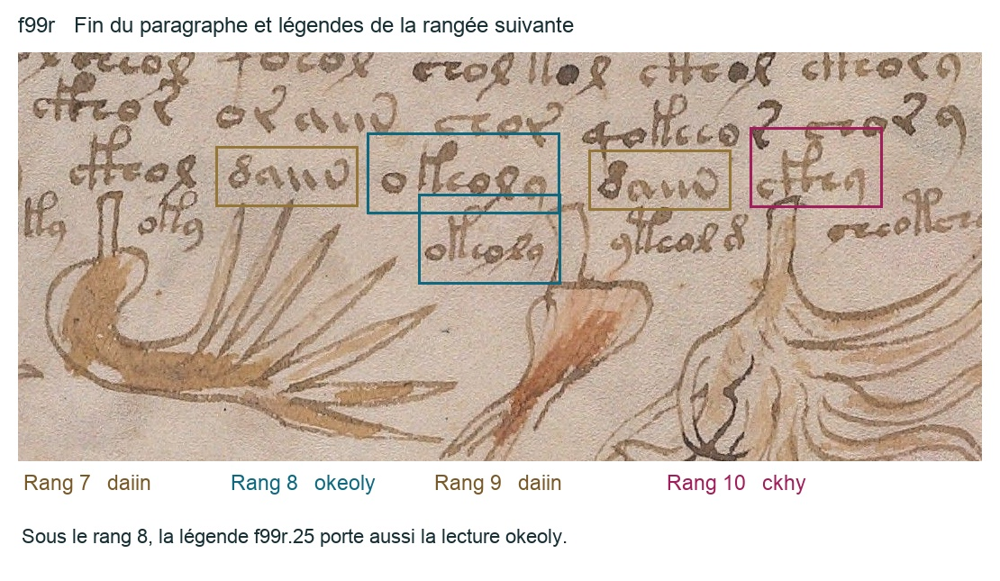

# Le mot sous la ligne et le groupe qui clôt le paragraphe

**La ligne f99r.18 finit par `daiin okeoly daiin ckhy`.** Juste en dessous du deuxième groupe encadré, l’inscription de dessin f99r.25 reprend `okeoly`. Les deux formes possèdent une boucle initiale isolée, une haute hampe, des traits bas et une finale qui s’infléchit vers le bas. De chaque côté du mot de la prose, les deux groupes `daiin` reprennent une grande boucle initiale suivie de petits traits. Le groupe final est matériellement distinct. Il commence par une forme à traverse et à traits hauts, et un espace le sépare du deuxième `daiin`. [Original Yale, f99r](https://collections.library.yale.edu/iiif/2/1006246/full/full/0/default.jpg)

| Source | Quatre derniers groupes de la prose | Inscription voisine |
|---|---|---|
| Takahashi H, EVA | `daiin okeoly daiin ckhy` | `okeoly` |
| Zandbergen–Landini ZL, EVA | `daiin okeoly daiin ckhy` | `okeoly` |
| First Study Group, alphabet FSG | `8AM ODCOEG 8AM DZG` | Aucune ligne f99r.25 dans cette édition |
| v101, alphabet propre à cette transcription | `8am ohcoe9 8am H9` | `ohcoe9` |

Dans H et ZL, les quatre traitements de la ligne placent `ckhy` au rang 10, à la fin du paragraphe. Le relevé ancien FSG donne dix groupes et la même répétition encadrant le huitième dans son alphabet. V101 comporte un blanc faible plus tôt dans la ligne ; le tableau y donne les quatre derniers groupes sans imposer les premiers numéros d’ordre. Dans l’interlinéaire de Stolfi, les lectures H et F de la dernière ligne du paragraphe donnent également la suite EVA entière. Il existe des liens entre les sources éditoriales ; leur accord ne constitue pas autant d’observations indépendantes. [Relevés, provenance et empreintes](SOURCES.json) · [Présentation des transcriptions](https://www.voynich.nu/transcr.html)

La proximité de l’inscription et de la prose se vérifie directement sur la photographie. L’attribution à une racine précise est plus incertaine. L’interlinéaire place f99r.25 près des pointes du cinquième dessin végétal de ce registre (son repère L2.5a). Il dénombre **sept dessins pour huit étiquettes** dans le registre des plantes. Le mot peut être repéré sur le parchemin, mais aucun trait ne le relie à un organe précis ni à l’occurrence de la ligne au-dessus. [Interlinéaire, rubriques P1.4 et L2.5a](https://www.voynich.nu/q19/f099r_tr.txt)

La [prédiction déposée](../PREDICTION.md) demandait une deuxième légende de fragment à la suite du deuxième `daiin`. Les unités EVA du modèle découpent `ckhy` en `ckh` puis `y`, soit deux unités. Le protocole avait donné trois unités au minimum aux candidats du panneau. Même en levant ce seuil, la forme entière `ckhy` n’apparaît à aucun locus de fragment Lf de H ou ZL sous les deux conventions de blancs. La prédiction échoue sur un groupe lisible. L’accord sur les signes ne donne pas le sens de `okeoly` ou de `daiin`.

Le script `python3 -B planche.py /chemin/vers/1006246.jpg` vérifie l’empreinte du cliché Yale et reproduit la planche. Les rectangles sont issus d’une transformation affine du repérage du visualiseur Voynichese vers le système de coordonnées de Yale, puis contrôlés visuellement. [Script de recadrage](planche.py) · [Répertoire de positions](https://www.voynichese.com/2/data/folio/script/f99r.js)
