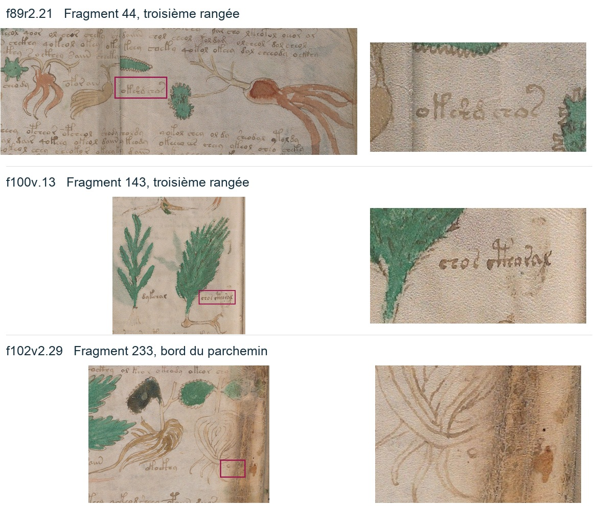

# Une troisième légende à la même place

**Les deux pages ne répètent pas une même suite de deux mots autour de leur paire en r/l.** Elles présentent cependant un autre rapprochement visible. Dans la troisième rangée de fragments végétaux, les trois unités transcrites `ch–o–s` apparaissent dans la dernière légende repérée avant le paragraphe, à la fin sur f89r2 et au début sur f100v. Nous avons annoncé ces trois signes pour une troisième légende choisie par sa place. Cette inscription est très effacée et la lecture attendue n’est pas confirmée. Dans un contrôle complémentaire, quatre légendes lisibles à la même extrémité d’autres rangées ont donné quatre mots différents, tous sans la suite annoncée.

## Ce que les deux transcriptions reconnaissent

La comparaison antérieure avait établi le passage de la légende `opcheor` à `opcheor opcheol` sur f89r2, et de `okcheor` à `okeor okeol` sur f100v après omission du signe transcrit ch. Nous avons ici comparé exactement les mêmes positions autour de ces paires. Les deux transcriptions modernes, H et ZL, ainsi que les deux lectures des petits blancs, fournissent le même relevé. [Comparaison publiée précédemment](../../2026-11-18-opcheor-paralleles/RAPPORT.md)

| Ligne de prose | Deux groupes immédiatement avant | Paire de repérage | Deux groupes immédiatement après, sur la même ligne |
|---|---|---|---|
| f89r2.22 | `qokeoefy sheey` | `opcheor opcheol` | `shody sholdy` |
| f100v.16 | `okeol ches` | `okeor okeol` | `dy`, puis fin de ligne |

Même en continuant sur la ligne suivante de f100v, on obtient `dy chockhey`, différent de `shody sholdy`. Les deux transcripteurs peuvent donc isoler avec constance les groupes autour de la reprise sur chaque page. Leurs lectures ne livrent aucune expression de deux mots commune aux deux pages aux places fixées. Aucune flèche ne relie cette prose à une des plantes. Le lien avec une rangée est spatial. [Photo de la ligne f89r2](../../2026-11-18-formes-souterraines/nom/photo/legende-et-prose.jpg) · [Photo de la ligne f100v](../../2026-11-18-opcheor-paralleles/variantes/photo-f100v/deux-finales.png)

## La légende qui permettait une prédiction

La dernière légende attribuée de la troisième rangée de f89r2 se trouve à droite du fragment 44. Le fragment 45 encore plus à droite est sans étiquette attribuée dans le registre. Takahashi sépare `okshd.chos`, tandis que Zandbergen–Landini écrit `okshdchos`. Sur f100v, la dernière plante étiquetée de la troisième rangée est le fragment 143. Les deux éditions y isolent `chos` au début, puis divergent sur le groupe suivant, `cthoral` ou `ctharal`. L’accord entre les deux pages porte sur les trois unités, avec un changement de position au bord de l’inscription. Le blanc avant ou après ne constitue pas un repère stable. [Registre physique des rangées](../../2026-11-18-ordre-des-noms/panneaux/RANGEES.json) · [Yale, f89r2](https://collections.library.yale.edu/iiif/2/1006233/full/full/0/default.jpg) · [Yale, f100v](https://collections.library.yale.edu/iiif/2/1006249/full/full/0/default.jpg)

Avant de lire un nouvel emplacement, nous avons annoncé la suite `ch–o–s` à l’un des deux bords de la dernière inscription identifiée d’une troisième rangée qui compte au moins quatre fragments étiquetés et qui précède immédiatement le début d’un paragraphe. Hors des feuillets de départ, le registre donne **un seul lieu**, f102v2.29, fragment 233. H propose `e???ddy`, ZL `os`. Le cliché montre des traits pâles au bord d’une zone abrasée. Un relevé antérieur décrit expressément l’effacement ; sa version H donne `e***ddy`, V laisse l’inscription illisible et U distingue un o initial. Il n’y a aucun succès selon le critère déposé. La conservation du parchemin empêche de restituer avec assurance le mot d’origine. Les quatre légendes témoins des fragments 229 à 232, situées à gauche dans la même rangée, n’offrent pas non plus cette suite dans les deux éditions. [Prédiction primaire](PREDICTION.md) · [Yale, f102v2](https://collections.library.yale.edu/iiif/2/1006252/full/full/0/default.jpg) · [Collation ancienne du panneau, repère L3.5](https://www.voynich.nu/q19/f102v2_tr.txt)

## Contrôle sur quatre légendes entières

Après avoir constaté l’usure de la cible, nous avons fixé une deuxième série avant d’en consulter les graphies pour ce test. Le choix conserve la fin de rangée, le minimum de quatre fragments étiquetés et la prose immédiatement en dessous. Il s’étend aux première et deuxième rangées et exclut désormais les feuillets 89, 100 et 102. Tous les lieux admissibles sont comptés.

| Lieu | Fragment | Mot selon H et ZL, deux conventions de blancs |
|---|---:|---|
| f88r.6 | 5 | `otaly` |
| f88v.5 | 16 | `otokol` |
| f99v.9 | 102 | `otoky` |
| f99v.20 | 108 | `osary` |

**Zéro réussite sur quatre cibles intégralement lisibles** dans le contrôle complémentaire. Les quatre inscriptions sont réparties sur deux feuillets. Elles mettent à l’épreuve la généralisation à la même extrémité de rangée. L’épreuve primaire particulière à la troisième rangée reste limitée par l’état du troisième dessin. Les trois unités des deux exemples initiaux ne justifient donc pas la lecture d’une expression ou d’un nom botanique. [Prédiction complémentaire](COMPLEMENT.md) · [Relevé complet, empreintes et témoins](RESULTATS.json)

Depuis ce dossier, `python3 -B verifier.py` reproduit le choix des lieux, les contextes et les deux épreuves. Le script de la planche utilise les coordonnées natives données dans son tableau, contrôle les empreintes des JPEG de Yale et conserve la couleur originale. La vérification photographique a été effectuée par un lecteur IA. H et ZL sont deux éditions modernes ; les quatre lectures comptées sont leurs deux traitements des blancs. Ces panneaux avaient déjà servi à d’autres travaux du projet. [Code de vérification](verifier.py) · [Sources de la planche et coordonnées](planche.py)
