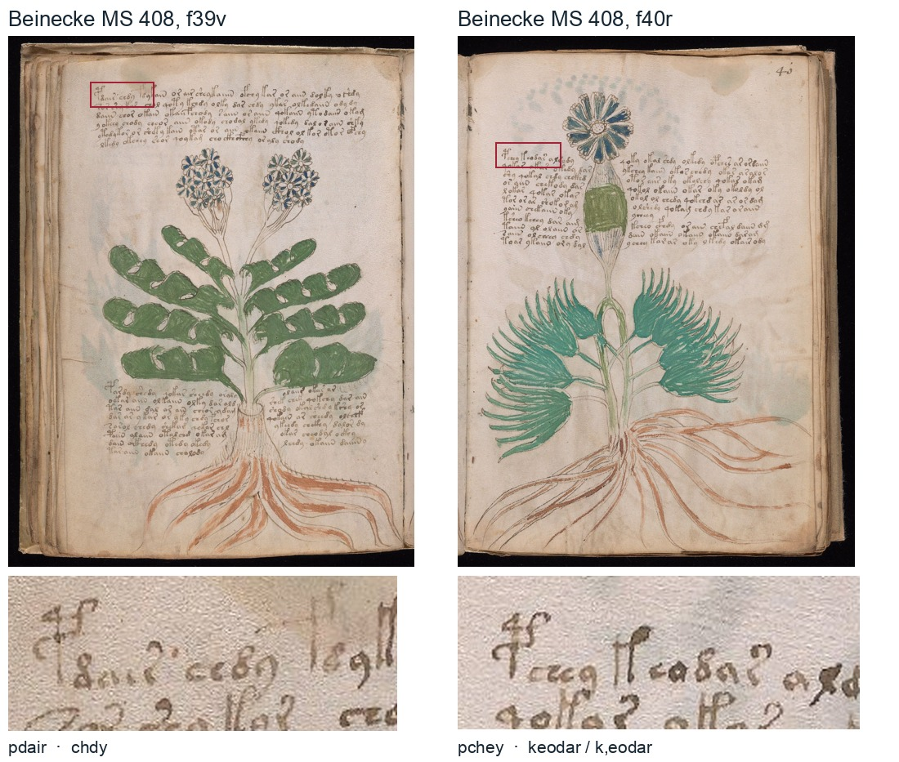

# Deux grandes plantes successives commencent-elles par le même signe ?

Dans les cahiers 4 à 7, nous avons prédit le premier signe d’une notice à partir de celui de la page précédente. Sur huit transitions entre feuillets comparables, six fournissaient une prédiction et cinq un résultat vérifiable. **Une seule prévision se réalise.** La réponse constante `p`, initiale la plus fréquente du lot d’apprentissage, en obtient trois sur les cinq. [Protocole](PROTOCOLE.md) · [Prédictions faites sur les versos](PREDICTIONS.json) · [Premiers mots des rectos et résultats](RESULTATS.json)

## Le seul accord, f39v et f40r

Le premier groupe est `pdair` à f39v et `pchey` à f40r. Les deux pages sont attribuées à la même main 2 et à la variété B de Currier. Le même signe haut ouvre la ligne. Ethel Voynich a proposé avec un point d’interrogation « primula » pour chacun des dessins, selon le catalogue. Il s’agit d’une double conjecture d’une même personne. La première plante porte deux groupes de petites fleurs ; la seconde, une fleur bleue et une tige dessinée en boucle. Le premier mot du paragraphe pourrait remplir d’autres fonctions qu’un titre. [Deux pages et leurs premiers groupes](premiers-mots.jpg) · [Notice du premier dessin](https://www.voynich.nu/q05/index.html#f39v) · [Notice du second](https://www.voynich.nu/q05/index.html#f40r)



## Ce que prédirait la lecture « primevère »

Un imprimé de Mayence de 1485 donne la graphie **Premula veris**, suivie de *maßlieben*. Une autre de ses rubriques porte **Herba paralisis** avec un autre nom vernaculaire. Les deux rubriques offrent des mots réellement imprimés et des alternatives à vérifier. Leur examen ne permet d’affirmer ni que ces deux entrées nommaient la même plante pour le compilateur ni qu’une de ces plantes est figurée dans le Voynich. [Agrandissement de Premula veris](premula-veris.jpg) · [Agrandissement de Herba paralisis](herba-paralisis.jpg) · [Vue 528 dans le Gart](https://www.digitale-sammlungen.de/view/bsb00032739?page=528) · [Vue 358](https://www.digitale-sammlungen.de/view/bsb00032739?page=358)

Supposons que `pdair` et `pchey` disent tous deux *premula*. Dans le modèle où chaque signe a une valeur constante d’une ou deux lettres et où `ch` forme un signe, **18 tables** permettent ces deux lectures. Même avec ce modèle contraint, **46 des 74 titres latins d’un seul mot du Macer** permettraient aussi d’ajuster les deux premiers groupes au même nom. En permettant trois lettres par signe, 69 des 74 titres conviennent. L’initiale partagée donne donc beaucoup de liberté pour attribuer un nom. [Toutes les tables dénombrées et les titres concurrents](PRIMEVERE.json)

La suite impose une contrainte de lecture plus précise. À f39v, le deuxième mot est **chdy**. Sa dernière unité `y` termine aussi **pchey** à f40r. Si `pchey` donne *premula*, la dernière lettre lue pour `y` doit être **a**. `chdy` doit alors finir par **a**, alors que *veris* finit par **s**. L’écriture *primula* a la même difficulté. L’autre rubrique, *herba paralisis*, reproduit le conflit entre **a** et **s**. F40r, de son côté, donne `keodar` ou `k` au deuxième emplacement selon la convention d’espacement ; aucune des deux lectures ne sauve la paire. Les seize combinaisons testées d’espacement, de segmentation du banc, de longueur maximale et de traitement du `p` initial conduisent à zéro lecture simultanée des deux noms de deux mots. Le rejet porte sur ces lectures précises et cette famille de clés, qui suppose les mots dans le même ordre sur les deux notices. [Critères fixés après le résultat sur l’initiale](PRIMEVERE.md) · [Calcul](primevere.py)

## Les deux lots et leurs témoins

Les transitions vont d’un verso au recto de la cote immédiatement suivante. Les deux pages doivent être botaniques, avoir des attributions de main et de variété connues et égales, appartenir au même cahier et à des bifeuillets différents. Le trou entre f11 et f13 interrompt la série. Les lectures Takahashi et Zandbergen–Landini ont été décomptées avec les petits blancs d’abord joints, puis séparés. Le signe doit être identique dans les quatre lectures au locus considéré. Si un mot comporte une forme incertaine qui empêche sa lecture simple, la case reste vide.

| Lot | Couples | Appels à partir du verso | Réussites / vérifiables | Accord moyen sous réaffectations | Réaffectations aussi bonnes ou meilleures |
|---|---:|---:|---:|---:|---:|
| Cahiers 1 à 3 (A–C) | 17 | 17 | 7 / 17 | 38,2 % | 429 / 864 (49,7 %) |
| Cahiers 4 à 7 (D–G) | 8 | 6 | 1 / 5 | 25,7 % | 206 / 288 (71,5 %) |

Les 17 transitions du premier lot touchent douze bifeuillets ; les huit du second en touchent huit. Plusieurs emplacements appartiennent au même parchemin. Les réaffectations exactes conservent ensemble les quatre faces d’un bifeuillet, son orientation, son cahier et la composition de ses cotes en mains, variétés et sections. Les feuilles incomplètes et les types rares sont parfois immobilisés. Le score compare les proportions sur les positions lisibles après chaque réaffectation. Les 864 et 288 configurations comptent les affectations physiques admissibles ; plusieurs donnent le même résultat.

Au lot de réserve, si l’on exige exactement les mêmes transitions lisibles au premier mot, au deuxième et à l’ouverture de la ligne suivante, il ne reste que trois couples. Ils donnent respectivement 1, 0 et 0 accord. En retirant une éventuelle potence initiale, on obtient un accord sur six couples lisibles. Pour l’ouverture de deuxième ligne, l’apprentissage seul donnait 7/16, atteint par seulement 30 des 864 réaffectations. La même comparaison dans la réserve donne 0/8. Aucun de ces contrôles ne confirme un ordre des noms.

Un témoin artificiel attribue la même initiale à quatre faces consécutives, puis la change. En apprentissage, le moteur retrouve 11 accords sur 17, ensemble égalé dans 32/864 configurations. En réserve, il retrouve huit sur huit, mais 32/288 configurations font encore aussi bien. Un fort classement artificiel peut donc rester non distinguable au seuil de 5 % sur ce lot réduit.

## Recto et verso d’un même feuillet

Après le résultat sur cinq transitions vérifiables, nous avons refait la prédiction entre les deux faces d’un feuillet. Cette comparaison ajoutée couvre davantage de notices. Elle est aussi plus exposée aux habitudes du scribe sur une même feuille. Dans les redistributions, les rectos sont maintenus à leur emplacement et les versos des feuillets conjugués se déplacent ensemble entre bifeuillets homologues. Les mots cibles ont été archivés séparément des appels. [Critères additionnels](RECTO-VERSO.md) · [Appels sur les rectos](PREDICTIONS-RV.json) · [Résultats sur les versos](RECTO-VERSO.json)

| Lot | Feuillets admis | Appels | Réussites / vérifiables | Réaffectations aussi bonnes ou meilleures |
|---|---:|---:|---:|---:|
| A–C | 22 | 22 | 8 / 21 | 556 / 864 (64,4 %) |
| D–G | 32 | 25 | 7 / 20 | 208 / 288 (72,2 %) |

Prédire toujours `p` donne 11/20 dans le second lot. Après retrait de la potence, on trouve 5/19 accords, avec 24/288 réaffectations aussi favorables (8,3 %), contre 2/20 en apprentissage. À dénominateur partagé dans le second lot, les trois emplacements de comparaison donnent 5/17, 3/17 et 4/17. Le changement d’orientation n’établit donc pas la prédiction recherchée.

## Contrôle sur des noms de plantes et reproduction

Dans l’ordre de l’édition des 77 notices latines du *Macer* utilisée par le projet, prendre l’initiale du titre précédent prédit correctement 10 des 76 suivants. Les deux premières lettres concordent trois fois. Si l’on trie alphabétiquement exactement les mêmes titres, on passe à 57/76 pour la première lettre et à 25/76 pour les deux premières. Un herbier que l’on sait lire peut donc présenter un signal très différent selon l’ordre matériel des notices. On ignore le rôle du premier groupe dans le Voynich, l’ordre originel de toutes ses feuilles et l’alphabet éventuellement représenté. Cette épreuve porte sur la succession conservée de sept cahiers. [Édition de calcul du Macer](../../2026-11-18-opcheor-paralleles/latin/SOURCE.md) · [Foliation et pages manquantes](https://www.voynich.nu/folios.html)

Depuis ce dossier, exécuter les commandes ci-dessous. Les programmes de texte emploient la bibliothèque standard. La planche demande Pillow et les deux JPEG institutionnels de largeur 1 500, dans l’ordre f39v puis f40r. [JPEG Yale f39v](https://collections.library.yale.edu/iiif/2/1006151/full/1500,/0/default.jpg) · [JPEG Yale f40r](https://collections.library.yale.edu/iiif/2/1006152/full/1500,/0/default.jpg)

```sh
python3 -B transitions.py predire
python3 -B transitions.py verifier
python3 -B recto_verso.py predire
python3 -B recto_verso.py verifier
python3 -B primevere.py
python3 planche.py f39v.jpg f40r.jpg
```

Les deux agrandissements du *Gart* sont les rectangles IIIF institutionnels renvoyés à la largeur de 1 320 pixels. [Premula, vue 528](https://api.digitale-sammlungen.de/iiif/image/v2/bsb00032739_00528/400,2870,2200,550/1320,/0/default.jpg) · [Herba, vue 358](https://api.digitale-sammlungen.de/iiif/image/v2/bsb00032739_00358/350,3120,2150,590/1320,/0/default.jpg)
