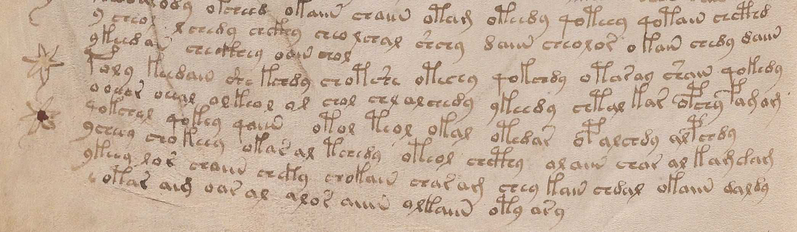
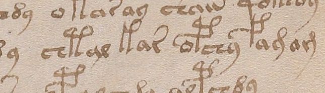
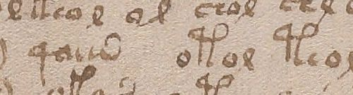

# Une rencontre à cheval sur deux lignes de f112v

**Les formes EVA `opchy` et `otol` se trouvent à cinq positions de distance, avec un retour de ligne entre elles, sur le verso du folio 112.** C’est leur seule rencontre à huit positions ou moins dans un même paragraphe du cahier 20, dans chacune des deux transcriptions et sous les deux conventions de coupure des virgules. Les graphies attendues et leurs lieux m’étaient connus lors de l’examen de la photographie. Il s’agit d’une vérification ciblée.

## Contrôle sur la photographie

[Bibliothèque Beinecke de Yale, MS 408, f112v, image 1006269](https://collections.library.yale.edu/catalog/2002046?child_oid=1006269) · [Photographie pleine résolution](https://collections.library.yale.edu/iiif/2/1006269/full/full/0/default.jpg)

La ligne 42 commence par un grand signe en regard de l’avant-dernière étoile, à centre clair. Sur la ligne 43, `opchy` est l’avant-dernier groupe à droite. Sur la ligne 44, `otol` occupe le quatrième emplacement à partir de la gauche. Le changement de ligne sépare les formes sans briser leur fenêtre de cinq positions.

| Extrait de Yale | Où regarder |
| --- | --- |
|  | `opchy` est le groupe à grande hampe qui suit `kar`, juste avant le dernier mot, transcrit `famom` par H et `famam` par ZL. |
|  | `otol` est le groupe central entre `qaiin` à gauche et `teol` à droite. |

La dernière étoile, à centre foncé, se situe en marge au niveau du passage des lignes 44 à 45. La ligne 44 occupe une grande partie de la largeur et la ligne suivante offre peu d’écart supplémentaire. L’image permet de reconnaître les deux mots et leurs lignes. L’attribution des deux à une étoile particulière demeure incertaine. Le catalogue dénombre treize étoiles, envisage douze ou treize paragraphes et relève expressément l’incertitude de la dernière division. [Description du folio dans le catalogue du cahier 20](https://www.voynich.nu/q20/index.html)

## Positions et limites

| Édition | `opchy` dans la ligne 43 | `otol` dans la ligne 44 | Paragraphe contenant les deux | Quatre mots intercalés |
| --- | --- | --- | --- | --- |
| H | 11e sur 12 | 4e | 42–47 | `famom` · retour de ligne · `qokchal qokey qaiin` |
| ZL, virgules jointes | 10e sur 11 | 4e | 42–44 | `famam` · retour de ligne · `qokchal qokey qaiin` |
| ZL, virgules coupées | 11e sur 12 | 4e | 42–44 | Les mêmes quatre mots que dans ZL, virgules jointes |

ZL ferme le paragraphe à la fin de la ligne 44 et en ouvre un autre à la ligne 45. H poursuit jusqu’à la ligne 47. Dans les deux éditions, les deux mots apparaissent à l’intérieur du même paragraphe. Le chevauchement des deux paragraphes est exactement **42–44**. La rencontre passe donc le critère de chevauchement et échoue au critère plus sévère d’identité de toute la liste des lignes du paragraphe. La distance reste égale à cinq lorsqu’on coupe le blanc incertain signalé plus tôt par ZL sur la ligne 43. [H, Takahashi](https://www.voynich.nu/data/IT2a-n.txt) · [ZL, Zandbergen–Landini](https://www.voynich.nu/data/ZL3b-n.txt)

## Reproduire le contrôle

Depuis la racine du dépôt, exécuter `python3 research/2026-11-18-paires-ingredients/rencontre112/verifier.py`. Le [lecteur](verifier.py) parcourt les paragraphes génériques P portant `$Q=T` et `$I=S`. Il compte les constituants incertains dans la distance et vérifie la paire exacte dans les deux ordres. Les [positions de chaque occurrence](positions.json) identifient les lignes et le rang des mots en comptant à partir de 1.

Les trois JPEG sont des régions de la photographie originale livrées par le serveur IIIF de Yale. Dimensions originales 2 664 × 3 697 pixels, SHA-256 `c421f574928c767cada83c01295370c078b66234610d262e286079a7a5a4cc1a`. Les quatre nombres de chaque lien sont les coordonnées x, y, largeur, hauteur en pixels de l’original.

- [Vue d’ensemble, 395,2630,2090,610](https://collections.library.yale.edu/iiif/2/1006269/395,2630,2090,610/full/0/default.jpg)
- [Fin de la ligne 43, 1815,2810,645,185](https://collections.library.yale.edu/iiif/2/1006269/1815,2810,645,185/full/0/default.jpg)
- [Quatrième mot de la ligne 44, 965,2885,500,135](https://collections.library.yale.edu/iiif/2/1006269/965,2885,500,135/full/0/default.jpg)
