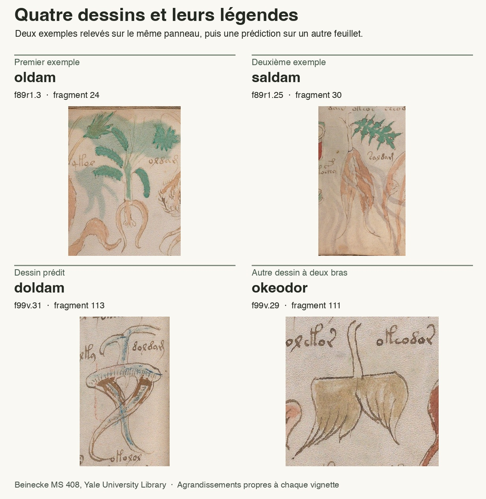

# Quels signes permettent de prévoir une racine fourchue ?

**Une prédiction faite à partir de deux légendes s’est vérifiée sur un autre feuillet.** Sur f89r1, deux fragments classés à deux bras par deux lecteurs IA portent les inscriptions `oldam` et `saldam`. Après observation de cette ressemblance, nous avons annoncé qu’une nouvelle étiquette terminée par `dam` accompagnerait elle aussi un dessin à deux bras. Hors des douze panneaux déjà cotés, une seule légende répond au critère, `doldam` sur f99v.31. Les deux lecteurs, sans voir les signes, y ont reconnu deux bras qui se croisent. [Prédiction déposée](https://github.com/alxbouchard/voynich-research/blob/3d926b0/research/2026-11-18-racines-fourchues/finale-dam/PREDICTION.md) · [Dessins et résultats du contrôle hors lot](finale-dam/RAPPORT.md)

Sur les cinq dessins de la rangée de f99v, deux ont reçu le classement « deux bras ». L’autre porte `okeodor`, sans cette terminaison. Dans les grandes pages botaniques, `oldam` réapparaît sur les deux faces du feuillet 34, dont les pieds présentent plus de deux bras principaux selon les lecteurs. La finale `dam` mérite donc d’être comparée dans d’autres inscriptions, mais la proposition de la traduire par « fourchu » échoue à rendre compte des emplois en prose. [Planche anonyme des cinq fragments](finale-dam/E/PLANCHE.jpg) · [Test dans la prose](finale-dam/F55-TEXTE.json)

## Le mot du premier dessin en Y

L’essai principal est parti du fragment brun en forme de Y sur f99v, associé par sa position à `arol`. Le registre compte 135 fragments sur les feuillets 88, 89, 100 et 102. L’intégralité du feuillet 99 était retirée de l’épreuve principale. Les prédictions pour le mot et ses extrémités ont été déposées avant les votes. Deux agents IA ont séparément classé tous les dessins anonymisés, inscriptions masquées, sans connaître les groupes attendus. Ils ont donné le même avis pour 120 des 135 positions, dont 29 indéterminées pour les deux. Ils distinguent 10 fourches à deux bras (Y/Y), 18 racines simples (S/S) et 63 racines à au moins trois bras sans paire dominante (M/M). [Protocole](PROTOCOLE.md) · [Annonces scellées](https://github.com/alxbouchard/voynich-research/blob/d67ec78/research/2026-11-18-racines-fourchues/ANNONCES.json) · [Photographies et masquage](images/PREPARATION.md) · [Tous les votes et croisements](RESULTATS.json)

Seulement cinq des dix Y/Y et onze des dix-huit S/S conservent une attache documentée et une légende entièrement lisible dans les quatre traitements. Les gauches et droites d’une même rangée, les deux faces d’un feuillet et les deux transcriptions d’un seul manuscrit ne fournissent pas autant de cas historiquement indépendants.

| Règle annoncée à partir de `arol` | Fourches reconnues sur les 5 | Fausses annonces sur les 11 racines simples |
|---|---:|---:|
| Mot entier `arol` | 0 | 0 |
| Finale `rol` | 0 | 0 |
| Finale `ol` | 1 | 1 |
| Début `ar` | 0 | 1 |

Les cinq légendes des fourches de la comparaison stricte sont `cheocthy`, `otokol`, `oldam`, `otoldy` et `saldam`. Une finale `ol` avait prédit le fragment 16 (`otokol`), mais également la racine simple 23 (`qkol`). Sur les 35 témoins simples ou multibras réunis, cette même finale donne six fausses annonces. [Détail par dessin, courtes inscriptions et désaccords](RESULTATS.json)

## Une règle apprise, puis une tentative de lecture

- **Début `oto`.** C’est la seule règle apprise auprès de fourches sur deux panneaux distincts du lot d’apprentissage. Elle prédisait un seul dessin à deux bras dans le second lot, le 219 près de `otory`. Les lecteurs ont répondu X/X. Sur le cliché original, un mince appendice est bien visible, mais son apparence ne permet pas de l’attribuer à une racine. Les deux Y/Y du lot de réserve sortaient de la comparaison stricte. Sur le 125, un contrôle local lit sans ambiguïté le début `sof` dans `sofal` ou `sofam`. Le début prédit y échoue. Sur le 209, aucune étiquette autonome n’est repérable. [Règle et annonces publiées avant le lot de réserve](https://github.com/alxbouchard/voynich-research/blob/f48da52/research/2026-11-18-racines-fourchues/APPRENTISSAGE.json) · [Fragment 219, masque et original](objet219/NOTE.md) · [Vérification des fragments 125 et 209](lecture/deux-fourches/RAPPORT.md)
- **Une lecture de `arol` comme nom de fourche.** Des tables donnant une ou deux lettres par signe s’ajustent à plusieurs mots proposés. À partir de l’anglo-normand *furche*, certaines prévoient `aro` ou `ar` pour la variante *furc*. Les 94 inscriptions végétales entièrement concordantes hors du feuillet 99, soit 98 mots, ne contiennent aucune de ces deux graphies ni `arol`. Le sens attesté de *furc* dans la source concerne la fourche d’un arbre. Aucune langue du Voynich n’est identifiée. [Attestations, contrôle chiffré et transfert](lecture/RAPPORT.md)
- **Le même mot dans une phrase.** Sur f40v.18, la photographie confirme les quatre signes de `arol` juste avant un grand motif rouge et vert qui interrompt la ligne. L’écriture reprend de l’autre côté avec `qokey okary`. Le motif ne présente aucune division unique en deux à cet endroit. Au bas de la page, deux pieds distincts portent plusieurs renflements. Aucune seconde légende autonome de même graphie n’a été trouvée ailleurs dans le manuscrit. [Les mots de part et d’autre du dessin](plante-entiere/mot/NOTE.md) · [Grandes plantes témoins et résultats](plante-entiere/RAPPORT.md) · [Recherche dans toutes les catégories de texte](hors-herbier/RAPPORT.md)

## Ce qu’écrivaient les copistes

Dans le Dioscoride de Salamanque, fin XVe siècle, le texte de l’orchis qualifie la racine de *διπλῆν*, « double ». L’image présente deux renflements l’un au-dessus de l’autre. Ailleurs, pour la mandragore, le texte décrit deux ou trois racines entrelacées ; l’image présente un corps humain dont les deux jambes restent séparées. Même quand on connaît la langue, une racine « double », une racine en Y et deux tubercules conduisent à des prédictions visuelles différentes. [Feuillet 104v du manuscrit de Salamanque](https://dioscorides.usal.es/manuscrito/104v.jpg) · [Feuillet 121v](https://dioscorides.usal.es/manuscrito/121v.jpg) · [Relevé des termes et comparaisons du XVe siècle](temoin/RAPPORT.md)

## Reproduction

Lancer `python3 -B annoncer.py`, puis `python3 -B analyser.py apprendre` et `python3 -B analyser.py verifier` depuis ce dossier. Le premier script relit les deux transcriptions IVTFF et la table de rattachement des dessins. Le deuxième utilise seulement les votes du lot A pour apprendre, puis les mots de B pour prédire. Le troisième ouvre les votes de B. Les distributions de contrôle sont calculées exactement en redistribuant les prédictions à l’intérieur de chaque panneau. Le dossier de la finale `dam` conserve séparément les calculs et les annonces postérieurs à cette première épreuve. [Code de préparation](annoncer.py) · [Calcul des scores](analyser.py) · [Registre historique des rangées](../2026-11-18-ordre-des-noms/panneaux/RANGEES.json)
