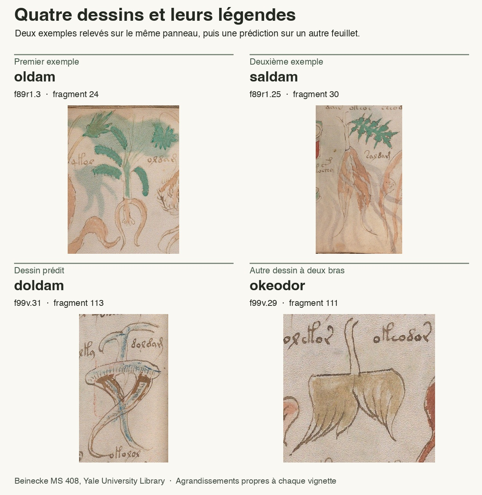

# Une terminaison commune a permis de prédire la forme d’un autre dessin

La légende `oldam` accompagne le fragment 24 au premier rang de f89r1 et `saldam` le fragment 30 au dernier rang du même panneau. Pour chacun, deux lecteurs IA séparés avaient relevé une base se divisant en deux bras. Nous avons retenu **après cette observation** la fin commune de trois signes, `dam`. Les deux exemples viennent du même panneau. Nous avons ensuite publié une prédiction qui portait sur tous les autres panneaux de fragments **hors des douze déjà cotés**. Toute nouvelle légende dont un mot se terminerait de la même façon devait accompagner deux bras principaux. [Prédiction publiée avant la recherche](https://github.com/alxbouchard/voynich-research/blob/3d926b0/research/2026-11-18-racines-fourchues/finale-dam/PREDICTION.md)

Sur les 69 autres lignes d’étiquette de fragment, 30 sont sur f99r, 21 sur f99v et 18 sur f101v. **Une seule fournit cette terminaison.** Sur f99v.31, les deux transcriptions écrivent `doldam`. Le mot contient même la forme entière `oldam` après un signe initial supplémentaire. Cette deuxième propriété a été remarquée après la recherche. La légende est attribuée au fragment 113, à droite du troisième rang. Les numéros sont modernes. La position locale et l’annotation éditoriale soutiennent le rattachement, même si d’autres dessins de ce rang ont plusieurs inscriptions. [Inventaire intégral des occurrences hors lot](LIEUX.json) · [Photographie du rang entier](RANGEE-E-CONTEXTE.jpg) · [Justification du rattachement](PREPARATION-E.md)

Les lecteurs ont reçu les cinq dessins du rang, dans un ordre mélangé, sans les inscriptions et sans connaître la cible. Tous deux ont donné Y au fragment 113 et décrit **deux bras qui se croisent**. La prédiction de leur nombre est vérifiée. Le croisement des bras a été décrit après ouverture. Ce panneau était nouveau pour le classement de cette terminaison ; l’équipe l’avait vu dans d’anciens travaux. Le préparateur connaissait la cible et a inclus tous les dessins du rang. [Planche transmise aux lecteurs](E/PLANCHE.jpg) · [Vote 1](E-1.json) · [Vote 2](E-2.json)

| Fragment en ordre matériel | Étiquette(s) dans les deux transcriptions | Code anonyme | Votes |
|---:|---|---|---|
| 109 | `okechy` | E3 | M/M |
| 110 | `otal` et `chor olekor` | E5 | M/M |
| 111 | `okeodor` | E1 | Y/Y |
| 112, voisin témoin préannoncé | `olky` | E4 | M/X |
| 113, cible préannoncée | `doldam` | E2 | **Y/Y** |

La ligne f99v.25 annotée comme légende du récipient porte aussi un identifiant éditorial 109a ; le tableau ne lui attribue pas le statut d’étiquette de racine. Le fragment 111 montre aussi deux bras avec une inscription sans `dam`. Sur ce rang, une position tirée uniformément aurait donc **deux chances sur cinq** de tomber sur un accord Y/Y. Cette fraction décrit les cinq choix disponibles et ne corrige pas la sélection de la terminaison sur f89r1. Les cinq dessins voisins et les deux avis d’agents d’une même famille de modèles ne sont pas des répétitions indépendantes. [Clé et coordonnées des cinq dessins](CLE-E.json)

## Ce que la même règle annonce en prose

Un rapprochement ancien, rapporté dans les notes de Theodore Petersen, propose de comparer la racine 113 à la grande plante de f55r. Il ne prouve pas que le dessin figure la même espèce. La prévision principale portait sur les trois mots entiers `oldam`, `saldam` ou `doldam` dans la prose du recto. Aucun ne s’y trouve. La prévision secondaire portait sur n’importe quel mot plus long se terminant en `dam`. **Les quatre traitements lisent `olkardam` sur f55r.7**, en fin de ligne au 7e ou au 8e rang selon les espaces. Cette terminaison est bien présente sur le cliché, mais la comparaison en rang strict ne la compte pas. [Photographie de la fin de ligne et provenance du rapprochement](f55r/NOTE.md) · [Prévision pour f55r](F55-AVANT.md) · [Tous les mots recherchés, rangs et longueurs](F55-TEXTE.json)

Sur les 19 autres faces botaniques de même main et de même classe, neuf présentent aussi un mot en `dam` avec accord à l’échelle de la ligne. Le suffixe est donc présent sur dix des vingt faces, et ne permet pas de retrouver une notice unique. Le mot entier `oldam` apparaît deux fois dans cet ensemble, en f34r.7 et en f34v.2, sur les deux côtés d’un même feuillet. Il manque dans la prose du panneau de départ f89r1, tout comme `saldam`. [Dépouillement du texte](texte.py) · [Contrôle du panneau de départ](verifier.py)

La présence de `oldam` sur f34r et de `olkardam` sur f55r a ensuite servi à prédire deux bras sur ces deux grandes pages. Les lecteurs ont examiné quatre pieds anonymisés. Tous deux ont donné M à f34r, dont les racines s’étalent en éventail, et M/M aux témoins f43r et f31v. Sur f55r, un lecteur donne M et l’autre X. Deux bras se croisent au centre, mais d’autres partent des côtés. Ces deux nouvelles pages n’ont donc pas validé la prédiction en prose. Sur f34v, déjà coté en aveugle pour l’étude du mot `arol`, la vue des racines complètes avait également donné M/M. [Annonce des deux pages](DEUX-PAGES-AVANT.md) · [Sélection et empreintes](DEUX-PAGES.json) · [Photos du dernier lot](F/CONSIGNE.md) · [Vote 1](F-1.json) · [Vote 2](F-2.json)
