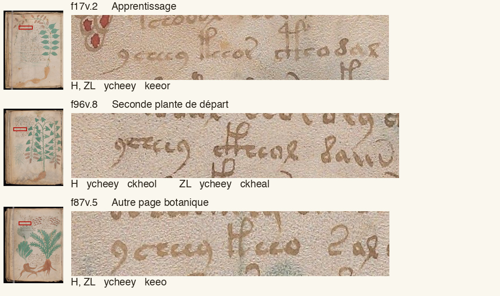

# Les baies et les débuts de ligne

Les notices des 34 grandes faces rapprochées d’un fragment décrivent des groseilles ou des baies sur f96v, f35v et f37r. Sur f96v et sur f17v, dont le dessin lui ressemble, la prose contient respectivement `ctheor` et `ctheol`. Peut-on reconnaître au moins une de ces graphies auprès d’autres dessins de baies ? La composition de ce lot repose sur les mots des notices. Une forme arrondie décrite comme un bouton ou un bulbe reste hors du lot. La comparaison est rétrospective car l’inventaire de ces graphies sur les 126 grandes faces botaniques et les 16 panneaux avait déjà été ouvert. [f96v](https://www.voynich.nu/q17/index.html#f96v) · [f35v](https://www.voynich.nu/q05/index.html#f35v) · [f37r](https://www.voynich.nu/q05/index.html#f37r) · [Règle de sélection](AVANT.md)

## Les deux autres plantes et leurs fragments

Aucune des quatre lectures de la prose sur ces quatre faces ne donne `ctheor` ou `ctheol`. Même résultat pour le troisième mot `ycheey`, choisi en masquant ces faces. Parmi les sept autres graphies communes aux deux faces de départ, chacune apparaît au moins une fois sur les deux. Avec trois autres feuillets botaniques sur soixante, `ycheey` est la moins répandue dans cette référence. Le choix et son classement sont consignés avant la recherche sur le lot des quatre faces. [Choix enregistré](ANNONCE.json) · [Lectures et témoins](OUVERTURE.json)

| Face | Positions alignées dans les quatre traitements | H, espaces joints / séparés | ZL, espaces joints / séparés |
| --- | ---: | ---: | ---: |
| f35v | 67 | 87 / 87 | 80 / 89 |
| f37r | 58 | 77 / 77 | 69 / 76 |
| f89r2, panneau du fragment 35 | 58 | 220 / 220 | 184 / 200 |
| f101v, panneau du fragment 188 | 0 | 167 / 167 | 152 / 168 |

Les dénominateurs H et ZL comptent les mots entiers lisibles de chaque édition, en joignant ou en séparant les espaces douteux. Le filtre d’alignement exige que les éditions placent les ruptures dues au dessin de la même manière sur toute la ligne. Sur f101v, les décomptes à une édition permettent de vérifier la transcription malgré l’exclusion de toutes les lignes par ce filtre. Aux légendes des deux fragments, les éditions diffèrent aussi. Sur f89r2.4, H donne deux mots `saloiin sheol` et ZL un seul `saloiinsheol`. Sur f101v.7, H donne `otorar` et ZL `otarar`. Les trois formes recherchées sont absentes de ces lectures. [Fragment 35](https://www.voynich.nu/q15/index.html#f89r2) · [Fragment 188](https://www.voynich.nu/q19/index.html#f101v)

Sur les 120 autres grandes faces, en lecture alignée, `ctheor` apparaît une fois sur une face, `ctheol` deux fois sur deux et `ycheey` trois fois sur trois. Les douze panneaux témoins donnent aussi des exemples de chacune des trois formes. L’essai ne fournit donc aucun mot entier utilisable pour prédire ces quatre images à partir des deux premières.

## La place de ycheey

Sur f17v et f96v, `ycheey` se trouve en tête d’une ligne. On a relevé ce détail après la sélection du mot, puis annoncé deux prédictions pour le reste du texte. D’abord, il devrait se retrouver au début des autres lignes qui le contiennent. Ensuite, si les deux mots initiaux formaient une formule fixe, le voisin que l’on lirait à droite sur f17v.2 devrait également suivre les autres occurrences. Ce voisin, `keeor`, a été consigné avant l’ouverture des autres voisins. Les quatre feuillets 17, 35, 37 et 96 sont exclus du comptage de position. [Prédictions](INITIAL-AVANT.md) · [Suite annoncée](SUITE-ANNONCEE.json)

| Prose avec quatre lectures concordantes du mot | Au début d’une ligne | Autre position |
| --- | ---: | ---: |
| Autres grandes faces botaniques | 2 | 1 |
| Autres sections | 12 | 1 |

Le mot commence donc la ligne dans 14 de ses 16 autres emplois alignés. Si, sur chaque face, il occupait la place des autres mots d’au moins deux signes commençant par `y`, la somme des fréquences observées pour ces témoins donne 6,64 débuts attendus sur 16, en pondérant chaque face par son nombre d’occurrences du mot. Les deux exceptions sont f40r.7, où il suit le dessin sur la même ligne, et f113v.2, où il est quatrième. Si l’on utilise une seule édition à la fois, le décompte botanique varie de 2/3 à 3/4 et celui des autres sections de 12/13 à 17/19. [Occurrences, contrôles et éditions](PLACES.json)

**La prédiction du deuxième mot échoue.** Sur 12 autres emplois où les quatre lectures permettent de vérifier le voisin sans franchir une coupure, aucun ne donne `keeor`. Sur f87v.5, les deux mots se transcrivent `ycheey keeo`, avec un seul signe de différence par rapport à f17v.2. Sur la seconde plante de départ, f96v.8, H donne `ckheol` et ZL `ckheal` ; cette différence exclut ce voisin du total de 12. Même sur f17v.2, l’ancienne lecture C donne `kshor` là où H et F donnent `keeor`. Sur f87v.5, numérotée 4 dans l’ancien compte, H, F et U donnent tous `keeo`. Ces appareils réutilisent en partie les mêmes transcriptions. [Ancien interlinéaire f17v](https://www.voynich.nu/q03/f017v_tr.txt) · [Ancien interlinéaire f96v](https://www.voynich.nu/q17/f096v_tr.txt) · [Ancien interlinéaire f87v](https://www.voynich.nu/q15/f087v_tr.txt)

Sur les trois images de Yale, on retrouve la séquence de tracés à la marge gauche du texte. Le groupe suivant sur f17v comporte à droite un trait ascendant qui manque au groupe de f87v avant le blanc. Sur f96v, la haute hampe du deuxième groupe traverse un élément horizontal ; le cliché permet de situer la suite même en conservant la divergence a/o. Ce rapprochement documente une habitude de position, sans fournir le sens d’un mot ou une formule de deux mots réutilisable. [Yale f17v](https://collections.library.yale.edu/iiif/2/1006107/full/full/0/default.jpg) · [Yale f96v](https://collections.library.yale.edu/iiif/2/1006245/full/full/0/default.jpg) · [Yale f87v](https://collections.library.yale.edu/iiif/2/1043429/full/full/0/default.jpg)

Les scripts `verifier.py annoncer` puis `ouvrir`, et `place.py annoncer` puis `ouvrir`, reproduisent les deux essais dans cet ordre avec Python. Pour la planche, placer dans un dossier les trois fichiers sources de chaque face nommés, par exemple, `f17v-n.jpg` (Yale), `f17v-r.jpg` (image de repérage) et `f17v-l.json` (coordonnées). Puis lancer `python3 photographier.py DOSSIER` avec Pillow, NumPy et OpenCV installés. Les neuf empreintes, les liens et les cadrages sont consignés. [Sources des images](SOURCES-IMAGES.json) · [Contrôle botanique](verifier.py) · [Contrôle de position](place.py) · [Cadrages](photographier.py)
