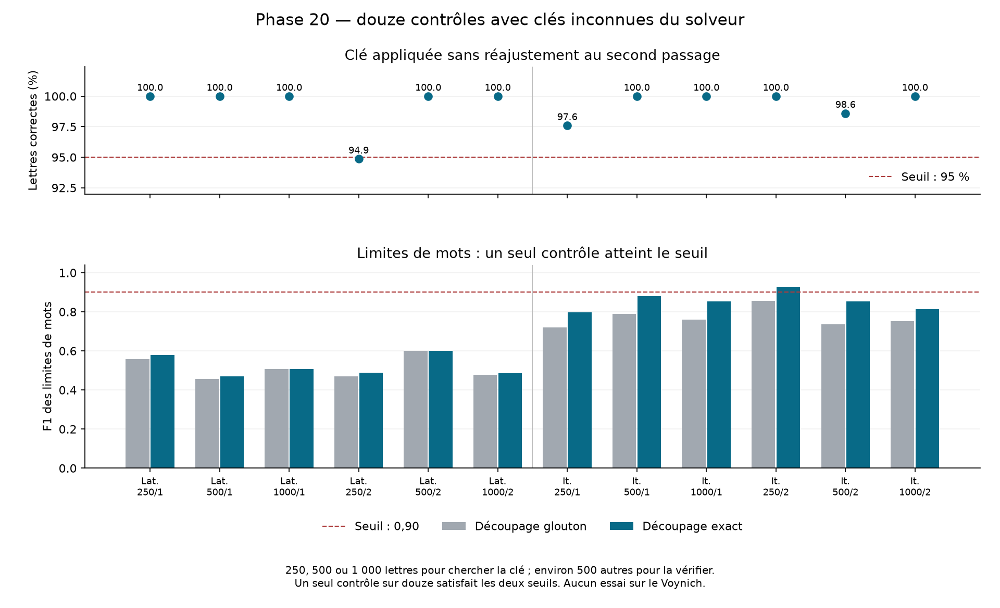

# Phase 20 — clés inconnues et espaces supprimés

**La configuration ne passe pas la calibration : 1/12 contrôle satisfait les deux critères fixés. Aucun essai sur le Voynich n'a été exécuté.**

Les clés sont cherchées sur un premier passage chiffré, sans connaître le
texte clair ni ses espaces. Elles sont ensuite appliquées sans changement
à un second passage. Les critères fixés exigent au moins 95 % de lettres
correctes et un F1 des limites de mots d'au moins 0,90 pour **chacun** des
douze passages réservés. Le seuil global est fermé.

## Dispositif et portée

Six contrôles latins (Pline) et six italiens (*Paradiso*) utilisent chacun
une nouvelle permutation de 26 lettres, avec espaces supprimés. La langue
est fournie. Les modèles sont appris sur César et *Inferno/Purgatorio*.
Les textes sont normalisés selon les conventions historiques du projet.
Les modèles de langue ne voient pas les passages de contrôle ; l'analyste
connaît toutefois les œuvres par les phases précédentes.

Le protocole, le moteur et le vérificateur sont figés dans **`be58b42`**
avant génération ou ajustement des douze chiffrés. Les tailles prévues
d'apprentissage sont 250, 500 et 1 000 lettres, deux passages par taille
et langue. Chaque transfert porte sur environ 500 autres lettres. Les
passages sont distincts, avec un intervalle de 50 mots entre ajustement et
transfert. Les graines ne sont pas sélectionnées selon le résultat.

Le moteur est une adaptation, pas une réplication du MCTS de Hauer,
Hayward et Kondrak. Une initialisation par quatre caractères propose des
clés ; le score combiné affine ensuite ces clés avec découpage glouton ou
exact. Les deux bras ont les mêmes points de départ et limites de recherche.
Voir [le protocole détaillé](CALIBRATION.md) et
[les paramètres figés](CALIBRATION_PROTOCOL.json).

## Résultats de transfert complets

Le F1 compare les positions des espaces proposés aux espaces réels : ce
n'est pas un pourcentage de mots traduits. « Lettres correctes connues »
est un diagnostic calculé après l'expérience, sans recherche de clé.

| Contrôle | Lettres correctes, exact | F1 glouton | F1 exact | F1 avec lettres correctes connues | Deux seuils atteints |
| --- | ---: | ---: | ---: | ---: | --- |
| latin_250_1 | 100,00 % | 0,56 | 0,58 | 0,58 | Non |
| latin_500_1 | 100,00 % | 0,46 | 0,47 | 0,47 | Non |
| latin_1000_1 | 100,00 % | 0,51 | 0,51 | 0,51 | Non |
| latin_250_2 | 94,86 % | 0,47 | 0,49 | 0,53 | Non |
| latin_500_2 | 100,00 % | 0,60 | 0,60 | 0,60 | Non |
| latin_1000_2 | 100,00 % | 0,48 | 0,49 | 0,49 | Non |
| italian_250_1 | 97,60 % | 0,72 | 0,80 | 0,88 | Non |
| italian_500_1 | 100,00 % | 0,79 | 0,88 | 0,88 | Non |
| italian_1000_1 | 100,00 % | 0,76 | 0,85 | 0,85 | Non |
| italian_250_2 | 100,00 % | 0,86 | 0,93 | 0,93 | Oui |
| italian_500_2 | 98,60 % | 0,74 | 0,85 | 0,89 | Non |
| italian_1000_2 | 100,00 % | 0,75 | 0,81 | 0,81 | Non |

Le bras exact restitue **5983/6028 lettres
(99,25 %)** sur les passages réservés, dont
9/12 entièrement corrects. 11/12
franchissent le seuil des lettres, mais seulement
1/12 celui des espaces.

Le découpage exact améliore le F1 dans **11/12**
contrôles et l'égale dans le dernier. Les moyennes des F1 par passage sont
0,64 (glouton) et 0,69 (exact).
Les F1 regroupant tous les espaces sont respectivement
0,63 et 0,67.
Ce petit jeu de contrôles ne mesure pas un taux général de réussite.

**La récupération des lettres vient surtout de l'initialisation** : elle
en restituait déjà 5982/6028. Les deux bras
finissent à 5983/6028. Le découpage exact ne
donne donc ici aucun gain supplémentaire de lettres par rapport au bras
glouton. Améliorer la segmentation n'équivaut pas à une nouvelle capacité
générale de déchiffrement.

## Diagnostic des échecs

Le dictionnaire contient les mots d'apprentissage et des lettres isolées.
Sur les passages réservés, environ **38 à 55 % des mots latins** et
**6 à 15 % des mots italiens** sont absents. Le moteur doit les couper en
fragments qu'il connaît. Même avec les lettres correctes imposées après
coup, le découpage reste sous le seuil dans onze contrôles sur douze.
Le calcul exact optimise correctement cet objectif limité ; il ne corrige
pas à lui seul la couverture lexicale et les probabilités du modèle.

Deux contrôles italiens perdent des lettres au transfert parce que les
signes correspondants n'apparaissaient jamais dans le passage d'ajustement :
12 lettres dans `italian_250_1`, sept dans `italian_500_2`.
Une correspondance non observée ne peut pas être déclarée retrouvée.

Dans `latin_250_2`, trois correspondances observées sont erronées et
produisent 26 erreurs au transfert. Le score d'ajustement de cette sortie
reste supérieur de **45,97847** unités de log naturel à celui des lettres
correctes découpées de manière optimale. Ce cas révèle une préférence
erronée du modèle ; augmenter seulement le budget ne suffirait pas à
faire du meilleur score une preuve de texte correct.

Tous les diagnostics, y compris les clés et scores de départ, sont
conservés. Aucun réglage ni critère n'a changé après ces observations.

## Vérification

- 28 contrôles de développement : quatre comparaisons de segmentation/score
  sur l'exemple anglais déjà connu et 24 chaînes courtes comparées à
  l'énumération exhaustive.
- Douze initialisations et 24 affinages de clé ; toutes les permutations
  produites sont vérifiées bijectives.
- **96 sorties** décodées et notées
  à nouveau par un code Python distinct ; chiffrés reconstruits depuis
  les vérités d'évaluation et métriques recalculées séparément.
- **48 optimums de segmentation**
  recalculés par un second programme dynamique, pour les sorties exactes
  et les lettres correctes connues.
- Écart maximal des scores : **5.46e-12**.

[Vérification structurée](results/calibration/verification.json) ·
[provenance et gel du code](results/calibration/provenance_verification.json) ·
[résultats détaillés](results/calibration/summary.json) ·
[agrégats et erreurs](results/calibration/aggregate.json).
Ces vérifications sont internes au projet, avec des sources et modèles
partagés ; elles ne remplacent pas une réplication externe.

## Conséquence pour la suite

Cette expérience satisfait la demande de tester des clés inconnues du
solveur avant le manuscrit. **La méthode actuelle n'est pas qualifiée pour
une application interprétée au Voynich.** Le résultat concerne cette famille
de substitution, ces corpus, ce dictionnaire et ce budget. Il ne réfute
ni toutes les méthodes de segmentation ni l'existence d'un message.

La prochaine correction à tester est une représentation explicite des mots
inconnus et des variantes historiques, avec pénalités calibrées. Les cas
actuels deviennent alors des données de développement : de nouveaux
passages réservés seront nécessaires pour évaluer cette correction. Les
témoins sans message restent requis avant une interprétation du manuscrit.
Aucune correction de ce type ni comparaison Voynich n'est exécutée ici.

[Reproduction et protocole](CALIBRATION.md) ·
[diagnostic anglais antérieur et attributions](README.md).
