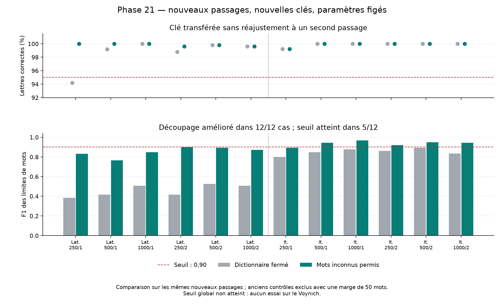

# Phase 21 — mots inconnus : progrès confirmé, calibration encore incomplète

**La correction améliore le découpage sur les douze nouveaux contrôles.
Elle satisfait les deux seuils dans 5/12 cas, contre
0/12 pour le modèle fermé sur ces mêmes passages.
Le seuil global exigeant douze réussites n'est pas atteint : aucun essai
sur le Voynich n'a été exécuté.**

## Séparation du développement et du test

Les 24 anciens passages de phase 20 ont servi à choisir un couple de
paramètres parmi 16 possibilités, en utilisant leurs lettres correctes.
Le meilleur F1 moyen de développement est 0,9178, avec coefficient
d'orthographe 1 et pénalité supplémentaire 0. C'est une mesure utilisée
pour régler le modèle, pas une performance réservée.

Le modèle, les paramètres, le générateur et le vérificateur ont ensuite
été figés dans **`8456988`**, avant sélection, génération ou ajustement des
nouveaux chiffrés. Les douze nouvelles paires de passages sont disjointes
entre elles et séparées d'au moins 50 mots des extraits de phase 20.
Les douze clés sont nouvelles. Les œuvres restent Pline et le *Paradiso*,
connues de l'analyste par le projet ; il ne s'agit donc pas d'un aveugle
global ou d'une préinscription externe.

Chaque clé est cherchée sur environ 250, 500 ou 1 000 lettres sans espaces,
puis appliquée sans changement à environ 500 autres lettres. La langue
est fournie. César et *Inferno/Purgatorio* servent seuls à entraîner les
modèles. Les graphies normalisées de phase 10 restent en vigueur.

## Résultats complets sur les passages de transfert

Les seuils fixés sont précision des lettres ≥95 % et F1 des espaces ≥0,90
dans chaque contrôle. Le F1 n'est pas un taux de traduction. La dernière
colonne de scores fournit les lettres correctes au seul découpeur, après
la recherche de clé, pour diagnostiquer ses limites.

| Contrôle | Lettres correctes, ouvert | F1 fermé | F1 ouvert | F1 ouvert, lettres correctes connues | Deux seuils |
| --- | ---: | ---: | ---: | ---: | --- |
| latin_250_1 | 100,00 % | 0,3854 | 0,8323 | 0,8323 | Non |
| latin_500_1 | 100,00 % | 0,4153 | 0,7665 | 0,7665 | Non |
| latin_1000_1 | 100,00 % | 0,5073 | 0,8492 | 0,8492 | Non |
| latin_250_2 | 99,60 % | 0,4159 | 0,8993 | 0,8993 | Non |
| latin_500_2 | 99,80 % | 0,5246 | 0,8944 | 0,8944 | Non |
| latin_1000_2 | 99,60 % | 0,5076 | 0,8721 | 0,8721 | Non |
| italian_250_1 | 99,20 % | 0,8000 | 0,8934 | 0,9113 | Non |
| italian_500_1 | 100,00 % | 0,8477 | 0,9434 | 0,9434 | Oui |
| italian_1000_1 | 100,00 % | 0,8764 | 0,9667 | 0,9667 | Oui |
| italian_250_2 | 100,00 % | 0,8601 | 0,9189 | 0,9189 | Oui |
| italian_500_2 | 100,00 % | 0,8921 | 0,9494 | 0,9494 | Oui |
| italian_1000_2 | 100,00 % | 0,8345 | 0,9435 | 0,9435 | Oui |

`latin_250_2` reste sous le seuil : **0,899328859**, même si un arrondi à
deux décimales afficherait 0,90. Le critère n'a pas été arrondi ou assoupli.

Le modèle ouvert restitue **6015/6024
lettres (99,85 %)**, avec toutes les lettres correctes
dans 8/12 passages de transfert. Les
correspondances de clé sont exactes pour tous les signes vus pendant
l'ajustement dans **12/12 contrôles**. Les neuf erreurs
de transfert portent exclusivement sur des signes absents du passage
d'ajustement ; leur correspondance ne peut pas être considérée comme identifiée.

La moyenne des F1 par passage passe de **0,6556 à
0,8941**. Les F1 regroupant tous les espaces sont
0,6357 et 0,9025. Le gain
apparaît dans les douze comparaisons, mais les textes proviennent de deux
œuvres : ce n'est pas une estimation générale d'un taux de réussite.

## Ce que la correction apporte et ce qu'elle ne résout pas

Le modèle fermé transforme les mots absents en fragments du dictionnaire.
Le modèle ouvert peut conserver une forme inconnue entière, évaluée par
son orthographe et sa longueur apprises sur l'entraînement. Il réapprend
aussi les probabilités lexicales avec une classe de mot inconnu : cette
comparaison évalue une configuration complète, pas l'effet isolé d'une
unique modification.

Les coupures superflues chutent de **1302 à 104**
sur les passages réservés. En contrepartie, les séparations oubliées
augmentent de **71 à 140**. Le moteur fusionne
encore certains mots voisins ou déplace leurs limites. Par exemple, sur
un passage latin connu, `suco quam` devient `sucoquam`, et `sextum` devient
`sex tum`. Ces exemples illustrent des erreurs de segmentation, sans
inférence sur le texte du Voynich.

Les six contrôles latins échouent au seuil des espaces même lorsque les
lettres correctes sont fournies. Le modèle ouvert atteint alors le seuil
dans les six contrôles italiens ; l'échec italien restant après recherche
de clé comprend quatre lettres dont le signe chiffré n'avait jamais été vu.
Cela oriente le prochain diagnostic vers les limites de mots latines et
la gestion explicite des correspondances non observées.

La récupération des lettres vient encore surtout de l'initialisation :
elle restituait 6014/6024
lettres, contre 6015 après l'affinage ouvert. Le bras
fermé finit à 5978. Dans ces contrôles, le nouveau score
préserve mieux les bonnes clés et apporte surtout un découpage plus fidèle ;
il ne constitue pas une nouvelle preuve générale de déchiffrement.

## Vérification et traçabilité

- 32 tests courts : C++, programme dynamique Python et énumération de
  **4 096** découpages concordent.
- Douze recherches initiales et 24 affinages, à budget identique entre les
  deux bras ; les vérités de contrôle n'entrent pas dans la recherche de clé.
- **120 sorties** reconstruites et notées par un
  second code ; métriques et chiffrés recalculés indépendamment.
- **48 optimums de segmentation ouverte**
  recalculés par un programme Python distinct ; écart maximal de score
  **6.82e-12**.
- Les 24 extraits correspondent aux sources ; les exclusions de phase 20,
  la disjonction des passages et les douze nouvelles clés sont vérifiées.
- Code et protocole figés inchangés après le début du test.

[Vérification](results/verification.json) · [résultats complets](results/summary.json)
· [agrégats et diagnostics des clés](results/aggregate.json).
Ces contrôles sont internes, avec les mêmes sources et modèles ; ils ne
remplacent pas une réplication externe ou une expertise linguistique.

## Conclusion opérationnelle

La prise en charge des mots inconnus apporte un progrès vérifié sur des
passages réservés. **La configuration reste insuffisante pour une application
interprétée au Voynich**, puisque sept contrôles échouent à la règle fixée.
Les résultats ne désignent ni la langue ni le procédé de rédaction du manuscrit.

La prochaine piste à tester est un modèle plus précis des frontières entre
mots, pour réduire les fusions abusives sans réintroduire les nombreuses
coupures de phase 20. Les signes jamais observés doivent rester explicitement
indéterminés. Toute correction utilisera ces résultats comme développement
et sera évaluée sur de nouveaux passages réservés. Les témoins sans message
restent nécessaires avant une interprétation du manuscrit.

[Méthode, reproduction et attribution](README.md) · [protocole figé](PROTOCOL.json).
